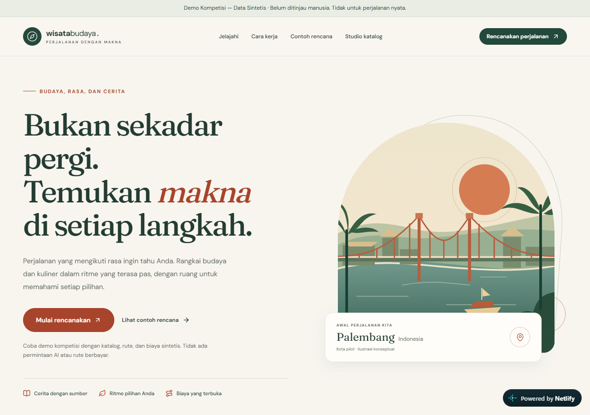

# Wisata Budaya Planner

**Perencanaan wisata budaya dan kuliner yang personal, transparan, dan sadar bukti.**

[Buka demo HTTPS](https://wisata-budaya-planner-demo.netlify.app/) · [Panduan demo](submission/DEMO_GUIDE.md) · [Presentasi PDF](submission/Wisata-Budaya-Planner-Presentation.pdf) · [Arsitektur](docs/ARCHITECTURE.md)



Prototipe untuk IT Festival 2026 — Vibe Coding Competition, dengan Palembang sebagai konteks kota pilot. Aplikasi menghubungkan preferensi perjalanan, pilihan budaya dan kuliner, waktu, kebutuhan makan, transportasi, serta anggaran rombongan dalam satu alur yang dapat ditinjau dan diedit.

> **Demo kompetisi — seluruh data runtime sintetis.** Situs publik memakai simulasi ranking dan fallback deterministik. Tempat, bukti, ulasan, harga, jam buka, layanan makan, dan rute contoh bukan informasi wisata Palembang yang telah diverifikasi secara independen. Jangan gunakan hasilnya sebagai panduan perjalanan nyata atau memasukkan data pribadi.

## Fitur yang dapat dicoba

- Penelusuran konsep destinasi sintetis dan formulir preferensi bertahap: tanggal, rombongan, anggaran, minat budaya, kuliner, moda, tempo, batas berjalan, serta inventaris makan.
- Rencana deterministik untuk 1–7 hari, dengan slot kunjungan, jendela buka, buffer, rute terarah, anggaran rombongan, kontingensi, dan cakupan kategori wajib.
- Makan yang dijadwalkan secara eksplisit, porsi yang sudah dianggarkan tetapi belum terjadwal, serta pengecualian tepat untuk porsi disediakan atau prabayar.
- Penggantian tujuan, penghapusan, pengurutan, kunci kunjungan, perbandingan sebelum/sesudah, komit eksplisit, dan riwayat revisi immutable selama sesi.
- Ranking kandidat yang dibatasi allowlist, kode alasan terkontrol, pemeriksaan bukti terkini, serta fallback deterministik saat keluaran rekomendasi tidak sah.
- Dashboard editorial dengan aktor dan ulasan **simulasi**, penolakan persetujuan sendiri, dan penarikan bukti yang memengaruhi hasil saat ini.
- Tampilan responsif, alur keyboard, pemulihan sesi kosong, dan unduhan TXT bertanda data sintetis.

Status `validated` hanya menyatakan pemeriksaan kontrak fixture sintetis berhasil. Bukti penting yang tidak tersedia menghasilkan `draft`; pelanggaran pasti menghasilkan `blocked`. Preferensi wajib dan kunci tidak dilonggarkan diam-diam.

## Peran AI dan batasannya

Alur rekomendasi: **preferensi tervalidasi → hard filter → ranking ID kandidat → validasi skema/allowlist/bukti → penjadwalan dan biaya deterministik**.

AI hanya boleh mengurutkan ID yang sudah diizinkan dan memilih kode alasan terkontrol. AI tidak menentukan kebenaran sejarah, membuat tempat atau harga, mengisi jam buka, memperkirakan rute dari geometri garis lurus, atau memutuskan kelayakan akhir.

Adapter Gemini server-side menggunakan SDK resmi dan telah diuji dengan mock. Satu pengujian live yang pernah diizinkan berakhir pada HTTP 502 / `UNAVAILABLE`, tanpa respons model yang tervalidasi. **Tidak ada klaim keberhasilan inferensi Gemini live.** Situs publik menolak endpoint live sebelum pemuatan layanan privat; tidak ada API Gemini atau routing berbayar yang diaktifkan.

Batas operasi tetap: maksimal 60 kandidat, dua upaya model termasuk perbaikan, 12.000 input / 2.000 output token per upaya, deadline bersama 45 detik, serta 42 upaya routing. Pengukuran token dan biaya mock bukan bukti tagihan atau latensi provider nyata.

## Jalankan secara lokal

Gunakan **Node.js 24 LTS** dan npm. Versi dependensi dikunci di `package-lock.json`. Tidak diperlukan akun, API key, file environment, atau database untuk mode offline.

```bash
npm ci
npm run dev
```

Buka [http://127.0.0.1:3000](http://127.0.0.1:3000). Runner hanya mengikat loopback dan mematikan telemetry framework. Jika port sudah terpakai, gunakan `npm run dev -- --port 3001`.

| Halaman | Fungsi |
| --- | --- |
| `/` | Landing dan penelusuran konsep sintetis |
| `/rencanakan` | Preferensi, ketersediaan harian, anchor, dan kebutuhan makan |
| `/rencana` | Hasil, perubahan yang dipratinjau, dan riwayat sementara |
| `/editorial` | Workflow bukti dan review yang seluruh aktornya disimulasikan |

Semua preferensi, hasil, riwayat, dan perubahan editorial berada di memori React. Reload atau hapus hasil mengakhiri sesi. Tidak ada penyimpanan traveler, login produksi, database, cookies, maupun local/session storage yang digunakan untuk menyimpan perjalanan.

## Verifikasi

```bash
npm run lint
npm run typecheck
npm run format:check
npm test
npm run build
npx playwright install chromium
npm run test:e2e
```

Di Windows dengan Microsoft Edge terpasang, jalankan `$env:PLAYWRIGHT_CHANNEL = "msedge"` sebelum perintah browser. Playwright memakai server lokal hasil build. Test provider selalu memakai mock atau gate live yang dinonaktifkan; jangan menjalankan pengujian terhadap layanan AI nyata.

**Hasil yang telah dijalankan dan dicatat pada checkpoint 24 Oktober 2026 WIB:**

| Ruang lingkup | Bukti aktual yang dipertahankan |
| --- | --- |
| Unit, integrasi, komponen lokal | 571/571 test, 42 file, 140,26 detik |
| Regresi Edge desktop/mobile lokal | 86/86 kasus; 42 scan axe, nol pelanggaran aturan yang dikonfigurasi |
| Korpus adversarial sintetis | 120 keluaran serangan ditolak, mencakup 12 kategori; termasuk dalam hasil lokal di atas |
| Browser anonim pada HTTPS publik | 16/16 kasus, 134,74 detik; 10 scan axe, nol pelanggaran aturan yang dikonfigurasi |
| Gate publik | Gemini GET dan POST malformed tanpa kandidat ditolak 403 `LIVE_DISABLED`; jalur environment, receipt, dan riset privat tidak tersedia |

Angka tersebut adalah hasil checkpoint yang telah dilakukan, bukan klaim bahwa setiap clone baru otomatis lulus. Pemeriksaan teknik tidak membuktikan kenyamanan traveler nyata, aksesibilitas menyeluruh, fakta budaya, rute lapangan, atau kesiapan produksi. Lihat [checklist penyerahan](submission/SUBMISSION_CHECKLIST.md) dan [audit produk](docs/PRODUCT_AUDIT.md) untuk batas bukti dan risiko yang masih terbuka.

Persiapan repository juga diuji dari salinan bersih sumber yang disanitasi: `npm ci` lulus dalam 177,93 detik (333 paket dari cache lokal menurut log npm, tanpa entri HTTP-fetch), kemudian build teroptimasi lulus dalam 82,23 detik. Salinan ini tidak memiliki file environment atau API key, memakai competition mode dan menonaktifkan live provider. Ini pemeriksaan instalasi/build tambahan; bukan pengulangan penuh suite atau pengujian provider live.

## Struktur dan keputusan teknik

```text
src/domain/                 Skema, bukti, planner, constraint, dan revisi
src/application/            Orkestrasi sempit planning, editing, rekomendasi
src/infrastructure/         Repository sintetis, fixture rute, adapter AI
src/features/               Intake, hasil, editor, rekomendasi, editorial
src/app/                    Next.js App Router dan batas server
tests/                      Komponen, integrasi, browser, dan adversarial
docs/                       Baseline produk, arsitektur, dan keputusan M1
submission/                 Panduan, slide, pitch, dan tangkapan layar aktual
```

Stack: Next.js App Router, TypeScript, Tailwind CSS, komponen Radix/shadcn, Zod, Vitest, Playwright, dan axe. PostgreSQL/PostGIS adalah arah arsitektur; tidak ada database produksi yang diprovisikan. Provider berada di balik interface; domain deterministik tidak bergantung pada SDK atau framework.

Dokumen utama: [Product Brief](docs/PRODUCT_BRIEF.md), [PRD](docs/PRD.md), [User Flows](docs/USER_FLOWS.md), [Architecture](docs/ARCHITECTURE.md), [Data Model](docs/DATA_MODEL.md), [Roadmap](docs/ROADMAP.md), dan [Decision Register](docs/m1/DECISION_REGISTER.md).

## Keamanan, publikasi, dan batas kesiapan

- Repository ini adalah proyeksi sumber yang disanitasi. Seluruh `.env*` termasuk contoh, credential, receipt lokal, riset yang belum dipublikasikan, bukti mentah, eksperimen historis, cache, build, dependency terpasang, log, dan arsip ZIP tidak disertakan.
- Jangan menambahkan secret ke browser, Git, screenshot, test, atau log. Mode offline tidak memerlukan credential. Tidak ada open-source license yang ditambahkan; akses publik tidak dengan sendirinya memberikan lisensi penggunaan ulang. Lisensi dependency tetap berlaku.
- Demo di-host pada Netlify Free dengan batas pengeluaran tunai USD 0. Kuota Free bersifat terbatas dan kehabisan kuota dapat menjeda situs. Tidak ada izin publikasi ulang yang tersisa dalam otorisasi deployment yang telah dipakai.
- **M1 tetap OPEN; penerimaan M2 dan peluncuran layanan wisata nyata belum diberikan.** Review budaya independen, kapasitas editorial berkelanjutan, lisensi provider, uji lapangan, privasi, dan persetujuan penyimpanan/deployment produksi masih menjadi gate.
- Panduan resmi, versi guidebook, dan deadline kompetisi yang direvisi belum terverifikasi. Tidak ada klaim kepatuhan resmi atau pengiriman formulir otomatis.

[Demo publik](https://wisata-budaya-planner-demo.netlify.app/) · [Repository](https://github.com/ardiradi/wisata-budaya-planner) · [Materi penyerahan](submission/README_SUBMISSION.md)
