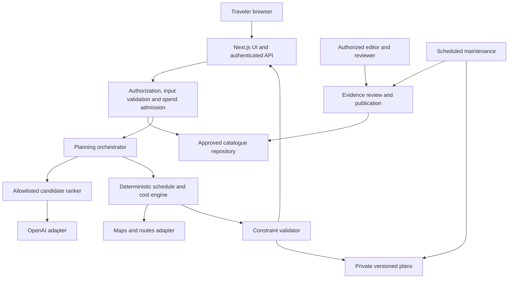

# Architecture

Current hosting exception,2026-10-24: **COMP-DEPLOY-NETLIFY-01** permits the competition-only synthetic demonstration on verified credit-based Netlify Free/USD0. The [actual public URL](https://wisata-budaya-planner-demo.netlify.app) passed anonymous desktop/mobile checks. Node24/OpenNext handles hosting assets and a server function; traveler/editorial state remains temporary browser memory. Explicit staging/build/tracing roots and filtered adapter output exclude private workspace data. Team AI Gateway is disabled and the application denies live providers server-side. This does not adopt Netlify for the eventual tourism service, production persistence, authentication, retention or M1/M2 acceptance. Both publication slots are consumed; no further deployment is authorized. [Execution and limits](../README.md#actual-netlify-public-execution--24-october-2026-wib).

Historical development checkpoint: **E2 local development** is authorized under [E2-01](m1/DECISION_REGISTER.md#13-e2-local-development-authorization), following Product Owner acceptance of the E1 local checkpoint. Scope: explicit evidence-bound meal scheduling, honest day utilization, lossless compact recommendation input and local UI/regression verification. Complete ranking, PD-01–PD-04 and all ceilings remain. No live API calls or E3 progression. M1 remains OPEN; M2/production acceptance is not granted. Historical phase descriptions below are retained as history, not new permissions. See the [product audit](PRODUCT_AUDIT.md) and [README](../README.md) for actual execution evidence.

## E2 local boundaries

Meal scheduling remains deterministic: validated input carries the explicit request; a synthetic service repository supplies independently labeled engineering fixtures; schedule code binds supported portions and service duration to a routed eligible venue visit. The cost ledger remains complete regardless of timing. Current service and venue evidence are checked before use and at current-result/revision boundaries. Missing service data cannot be replaced by AI or a food-venue tag.

Day density is a soft target constrained by hard coverage, future-day inventory, route/time/walking/budget/lock limits. A bounded sparse search is not a global optimizer; report its limits and preserve short plans. AI continues to rank an immutable original approved set only. A versioned compact input is tested for exact reconstruction of the preceding projection while complete-ranking output and deterministic validation/fallback remain unchanged. E2 permits only offline/mock verification; it does not reactivate GEM-01, adopt production persistence or prove provider tokenization/admission.

Current local exception,2026-10-23: COMP-01 supersedes B3 stop checkpoints for the competition package and a synthetic editorial demonstration. GEM-01 subsequently permits the official server-only Gemini adapter and exactly one owner-authorized Free Tier attempt. The shared React-memory editorial session exposes current catalogue heads to planning/editing; drafts preserve active records, simulated distinct review rotates heads, and withdrawal suppresses current facts while private revision bodies remain immutable. These actors are not authentication or independent human review. The isolated Gemini route rebuilds the original baseline, accepts compact ID/reason output only and hydrates local evidence; edited editorial catalogues remain offline-only. SDK retries are disabled, one exclusive local receipt consumes every dispatched/uncertain attempt and 12-second transport handling shares the45-second planner ceiling. The actual2.5Flash attempt failed with local502/no validated response; offline fallback remains available and further live dispatch is disabled. See [current decisions](m1/DECISION_REGISTER.md#10-local-competition-finalization-authorization) and [actual execution](../README.md#competition-finalization-results). Earlier B3-only statements below are historical scope; production/right/human-review/retention gates remain unchanged.

Planning baseline: 2026-10-22; authorization updated 2026-10-23. Direction approved; [DEVB3-01](m1/DECISION_REGISTER.md#9-controlled-local-phase-b3-authorization) permits controlled local Phase B3 AI recommendation and personalization readiness, following reported B2 review. Use synthetic catalogue/route/cost fixtures, a mock ranker and temporary local in-memory inputs/results/revisions. M1 remains OPEN and M2 acceptance is not granted. Real provider configuration/adoption, production persistence and release remain conditional. Product scope and release requirements live in [PRD](PRD.md); entity contracts live in [DATA_MODEL](DATA_MODEL.md). See [M1 report](m1/M1_REPORT.md) for evidence and open gates.

Product Owner update, 2026-10-23: **PD-01–PD-04 product directions are approved**, as recorded in the [decision register](m1/DECISION_REGISTER.md). Confirm necessary daily meal inventory including partial days and exact provided/prepaid portions; retain walking presets and pace stop caps; fulfill each mandatory cultural category through at least one eligible visit across the trip; and apply PD-04 Option A with sparse routing preferred only where all hard requirements remain satisfied. These approvals preserve all existing operating ceilings and do not establish factual, rights, measurement or production-feasibility evidence.

The [blocker-resolution package](m1/BLOCKER_RESOLUTION_PACKAGE.md) retains the evidence dependencies. Geoapify remains a candidate, paid embedded browser Maps stays disabled pending a separate rights/budget decision, and the volatile storage proposal is unadopted pending cost, retention and privacy review. Outside the expressly recorded GEM-01 and competition-only Netlify exceptions above, live-test Stage B/C spending, credential configuration, provisioning and public deployment remain unauthorized. The 30-place M5 target is retained; the Product Owner confirms 20+ curator hours/week while the independent reviewer remains unassigned at 0 confirmed hours. Sustainable capacity remains unproven. The historical B3 boundary was a synthetic mock-readiness exception, not real provider/storage adoption or a completed milestone; its phase stop was superseded only by the subsequent recorded authorizations. Real AI/provider requests/configuration, authentication, production saving and editorial administration remain outside B3.

## 1. Design position

Use a modular monolith with a deterministic itinerary engine and a reviewed, independently licensed destination catalogue. AI proposes preferences and ordering within an allowlist. It does not supply place identities, historical claims, prices, opening hours, route durations, or the final feasibility decision.

The B1 core implements this separation with pure runtime-validated domain contracts, a mock/local repository and provider-independent deterministic routing fixtures. Domain code owns normalization, hard filtering, ordering/schedule generation, costs and status; no AI selection or real provider dispatch occurs. Bind each synthetic route/evidence reference to exact city, endpoints, mode, departure assumptions and immutable fixture versions. Recheck opening windows, date exceptions, dwell, buffers and the return leg for generated schedules; unknown essential evidence cannot become zero cost, all-day opening or a passing result. Synthetic `validated` means fixture checks pass, never real Palembang verification. Actual B1 verification is retained in README. For B2, keep edit/revision services independent of React and Next.js. Runtime-validate commands against an explicit base revision; produce a separate proposed result, immutable input/evidence/validation snapshot and before/after comparison. Commit by compare-and-swap of the current revision only after an explicit action; draft/blocked commits need explicit acknowledgement and retain the last-valid revision. Revert creates a new current revalidation, not a mutation or revival of old validation. Preserve stable logical stop IDs and explicit lock dimensions. Treat route identity as exact directed endpoints/access revisions, mode and departure assumption: invalidation can cascade downstream. Every preview/revert has the existing 42-attempt and 45-second ceiling; no cache hit or straight-line distance can certify an incompatible leg. An in-memory revision store models local concurrency only and does not claim database transactions, cross-tab synchronization, durable retention or account ownership. Food repetition stays conservative pending a separate product decision. Actual B2 results belong in README only after verification.

The pilot supports one city per trip. Every catalogue and planning boundary carries a city ID, currency, locale and IANA timezone so another city can be enabled through data and configuration. Do not build a multi-city optimizer or microservice estate before pilot evidence justifies it.

Local B2 boundaries are `domain/editing` for strict commands/pure lock operations, `application/editing` for the memory-only revision controller and evidence projections, and `features/editing` for comparison/commit/history UI. The planner accepts an explicit bounded stop sequence and fully recomputes all directed legs per preview/revert; commit does not reroute. Cancellation discards late completions. Locks fix place/date/index/start/dwell, and reversion restores choices/order against current inputs and locks. No production caching, spend ledger or persistence architecture is adopted. Actual results and local editing limits are in the [B2 README](../README.md#phase-b2-results).

## 2. Stack evaluation and provisional choices

| Concern | Proposed choice and reason | Alternative and tradeoff | Commitment gate |
| --- | --- | --- | --- |
| Web/API | Next.js App Router, TypeScript, Node runtime; shared UI and server contracts suit a small team | React/Vite plus Fastify separates hosting and API scaling but adds deployment/auth integration; a separate API becomes useful for mobile clients or long jobs | Confirm supported stable releases, security advisories and hosting behavior at M1 |
| UI | Tailwind CSS and selectively adopted shadcn/ui components; tokens and owned components permit accessible customization | A larger packaged design system reduces initial work but adds conventions and bundle cost; plain CSS is viable but needs more component work | Keyboard, focus and mobile prototypes meet PRD accessibility gates |
| Persistence | Supabase PostgreSQL/PostGIS and Supabase Auth; relational provenance, transactional edits and spatial lookup in one service | Managed PostgreSQL plus a separate identity provider is portable but requires more operations; document storage makes evidence/version constraints harder | RLS, backup, region and restore proof at M1 |
| DB access | User-scoped Supabase client for owner data; narrowly scoped server RPCs for transactions; direct SQL only for worker/admin use | An ORM helps ordinary CRUD but does not replace PostGIS, RLS or reviewed SQL; choose one only after a schema spike | Pooling, migration and role tests; no privileged client as a universal repository |
| AI | OpenAI Responses API through one server adapter with strict structured output | A deterministic ranker alone costs less and is the required fallback; other model adapters may later compete in the same evaluation suite | Choose model/snapshot by groundedness, latency and measured cost; no model selected by reputation alone |
| Maps/routing | Provider-neutral adapter; Google remains conditional and Geoapify is a clarification candidate, with no provider adopted. Paid embedded browser Maps remains disabled | Licensed hosted OSM routing or self-hosted routing needs separate data/software/service rights, attribution, coverage and operating-cost assessment | Written content-use policy, attribution and mode/bridge evidence before provider-dependent code; separate rights/budget approval before a paid browser embed |
| Tests | Vitest for pure planning/adapter contracts; PostgreSQL integration tests; Playwright for browser journeys | Browser-only testing misses constraints and is slower; snapshots alone cannot prove feasibility | Representative fixtures and adversarial corpus agreed at M1 |
| Source/release | Local Git initialization is authorized for Phase A. GitHub, protected pull requests/Actions and Vercel remain future release candidates | A Docker Node service offers long-job and infrastructure control but needs more operations | No external repository or deployment is authorized; confirm actual runtime/region and obtain separate external-action approval |
| Background work | Bounded request execution for generation, with durable run records; scheduled, resumable maintenance jobs | A durable queue/worker adds operational work but is required if chosen runtime cannot safely finish bounded jobs | Load spike decides synchronous feasibility; otherwise use a queue before pilot, never fire-and-forget work after a response |

M1 records actual local runtimes and checks dependency needs; isolate any installed experiment dependencies and their lockfile under `experiments/m1/`. No dependency installation is required for the retained Node built-in experiments. DEVA-01 separately authorizes supported root Next.js/TypeScript/Tailwind/selective shadcn/ui tooling and Vitest/Playwright dependencies with a lockfile for the local Phase A application. Record actual selected versions/commands in the application README; framework compatibility does not establish production hosting/runtime suitability. Avoid an agent framework, vector database, Redis, Kubernetes, event bus or custom routing infrastructure without an observed need. A small relational catalogue can use taxonomy, SQL and PostGIS candidate retrieval.

These are engineering recommendations informed by current provider capabilities, not a claim that a framework proves production readiness. Relevant constraints are documented in [Next.js authentication](https://nextjs.org/docs/app/guides/authentication), [Supabase RLS](https://supabase.com/docs/guides/database/postgres/row-level-security), [PostGIS](https://supabase.com/docs/guides/database/extensions/postgis), [database connections](https://supabase.com/docs/guides/database/connecting-to-postgres), and [Vercel execution limits](https://vercel.com/docs/functions/limitations). Sources were checked on 2026-10-22 and must be rechecked at integration.

## 3. Components and trust boundaries

The diagram describes logical modules, not separate deployed services. Only the server may call AI and routing APIs or inspect private evidence. Paid embedded browser Maps remains disabled. If a later separately approved embed uses a browser key, it is necessarily public: restrict it to allowed origins and required browser APIs; use separate server credentials and restrict those using supported provider controls. Never expose a service-role database credential or OpenAI secret.

Proposed module boundaries after approval:

| Module | Responsibility | Must not do |
| --- | --- | --- |
| `catalogue` | City/place identity, publication, evidence eligibility and retrieval | Treat a search result or LLM answer as verified |
| `preferences` | Parse dates, group size, budget, interests and hard/soft constraints | Silently relax requirements |
| `planning` | Pure ranking fallback, scheduling, bounds, warnings and validation | Import UI, provider SDKs or database clients into core algorithms |
| `ai` | Provider requests, schema parsing, candidate ID membership, reason-code output | Set final facts, times, costs or permission decisions |
| `maps` | Routing, external place links, attribution and policy-aware transient content | Make straight-line distance look like a navigable route |
| `itineraries` | Ownership, immutable revisions, edit locks and idempotency | Overwrite a user's previous valid version |
| `editorial` | Human review, changes, conflicts, publication and source revocation | Permit model output to approve itself |
| `operations` | Quotas, run leases, cost ledger, telemetry and deletion | Record full prompts, precise locations or dietary data in general logs |

Dependencies point toward domain interfaces. Provider DTOs stay in adapters. Translate external errors into documented domain outcomes. Shared runtime schemas validate all untrusted inputs, not just TypeScript types. Keep configuration versioned and separate from code; secrets remain in managed environments.

## 4. Request and version contracts

The planned interface is a typed JSON API; transport details may change during M1 without changing domain contracts. Dates are destination-local dates, duration is derived inclusively, and timestamps in persisted events are UTC.

| Operation | Intended behavior |
| --- | --- |
| List enabled cities/catalogue | Return only a publication-approved public projection, with evidence labels and permitted attribution |
| Create generation | Validate request; require idempotency key; return run ID plus result when bounded work completes, or accepted status if a queue is adopted |
| Read run | Authorize by account or server-issued guest session; expose lifecycle and sanitized error code |
| Edit version | Require expected current revision; accept swap/remove/reorder/lock/preferences patch; create a new candidate revision and revalidate |
| Save guest plan | Authenticate, check guest-session ownership and expiry, then atomically copy the permitted request/version/child graph into a new account-owned lineage using a consumed single-use claim; original guest graph keeps its expiry. Never trust a submitted owner ID |
| Read/delete saved plan | Owner-only; return current validation freshness; cascade private children and enqueue deletion of derived data |
| Review/publish assertion | Authorized editorial endpoint with reason, evidence and immutable review event |

An idempotency key is scoped to principal and operation. Its stored normalized request hash must match retries; a changed payload with the same key returns a conflict. Optimistic concurrency rejects stale edits with a conflict and preserves both user input and current revision for explicit resolution. Error envelopes carry `code`, safe message, field errors when relevant, correlation ID and retry advice; never include raw upstream payloads.

Saving rewrites all ownership/parent references in the permitted cloned graph and consumes a guest-session-bound claim so a second account cannot replay it. Temporary precise anchors do not become durable through copying: ask the traveler to confirm coarse/canonical replacements, create a corresponding new request and revalidate. Otherwise save only a clearly marked draft with expired-location tombstones. Purging coordinates must also remove reconstructable private route derivatives/hashes where required; schema tombstones permit lawful deletion without breaking endpoint references.

Generation lifecycle is `queued | running | succeeded | failed | cancelled`. It is separate from itinerary result status: `validated | draft | blocked`. A successful run can produce a useful draft or a blocked explanation. Cancellation is best effort for in-flight provider work and does not erase incurred cost.

## 5. AI orchestration

**Current B3 local boundary:** implement a provider-independent ranking interface with a deterministic mock adapter, not a Responses SDK/client or live endpoint. The provider-neutral contract carries strict versioned structured IDs, bounded alternatives, permitted immutable assertion references and controlled reason codes. Feed only validated structured preferences and the original hard-filtered city/date-eligible candidate snapshot; do not send raw catalogue/source prose as instructions. Revalidate schema, exact allowlists, category assignments, reason preconditions and current heads after every attempt, before handing rankings to the unchanged deterministic planner. A malformed response or known provider failure can use bounded deterministic fallback; uncertainty cannot admit an ineligible candidate. Preserve B2 edit/revert/lock contracts; no new model call is needed for ordinary edits and no alternative can be silently committed.

Mock ranking, repair/retry, fallback and deterministic planning share one 45-second deadline from operation start. Count at most two simulated model attempts, each under 12,000 input/2,000 output token ceilings;60 candidates,42 route attempts, matrix and money caps stay unchanged. B3's `ceil(UTF-8 JSON bytes / 4)` token proxy and simulated admission are local controls, not a real tokenizer bound/rate quote, transactional spend ledger or provider latency proof. Each admitted attempt reserves 500,000 simulated micro-USD without refund within the operation; the 250ms per-attempt fixture timeout is not a production provider timeout decision. Refusal is not retried; repair receives only a rejection enum. Explicit cancellation and the shared budget both prevent late ranking/fallback publication. Record actual synthetic/adversarial outcomes in README. The production orchestration below remains a target for a separately approved integration; its references to Responses, spend reservations and writes do not authorize SDK dispatch, credentials, storage or account setup in B3.

1. **Normalize and admit.** Enforce supported city, 1–7 days within 90 days, 1–8 travelers, integer IDR group budget, daily available windows and supported transport. Treat food/accessibility requirements explicitly marked essential as hard constraints. Reserve provider spend atomically before external calls.
2. **Retrieve.** Fetch up to 60 approved candidates using city, active identity, taxonomy, spatial bounds, evidence freshness and hard requirements. Unknown or conflicting essential evidence excludes a candidate. Keep excluded reasons available to explain an empty result.
3. **Build permitted context.** Send only canonical IDs, preference tags, reviewed independent summaries/claim IDs, dwell estimates and reason codes needed for ranking. Exclude account identifiers, precise hotel/address coordinates, allergy free text, provider-restricted payloads and source HTML. Selection must work without Google content being sent to a model.
4. **Rank.** Use one Responses request with strict JSON Schema. Output contains selected `place_id`, candidate `assertion_id` references, day preference, `reason_code` from an enum and alternatives; no narrative factual fields. Every object rejects additional properties. Enforce maximum items, allowlist membership, duplicate policy and claim-to-place linkage in application code. Schema adherence alone cannot establish truth. Handle refusal and incomplete output explicitly. [Official structured-output guidance](https://developers.openai.com/api/docs/guides/structured-outputs).
5. **Schedule and cost.** The deterministic engine chooses slots, meals/breaks and routes from approved candidates. The model's day preference is soft. No raw model text becomes cultural context: render reviewed localized claim text and templated recommendation reasons.
6. **Validate.** Run every hard check after complete cost/route calculation and on every edit. Reject unknown IDs or evidence mismatches before rendering anything from the model. Refresh final candidate eligibility immediately before committing a version to prevent publication races.
7. **Repair once at most.** Prefer deterministic remove/swap/reorder repair. One additional model request is allowed only for a transient/schema failure or rerank and only within the same run's token, time and money caps. SDK automatic retries must be disabled or counted centrally. A refusal is not retried to evade it. Do not run open-ended agent/tool loops.
8. **Commit and explain.** Atomically write an immutable result, evidence references, checks, versions of algorithm/prompt/model/config and cost usage. Display assumptions, unknowns and next actions. Save a last-known-valid pointer separately from the latest attempted edit.

Fallback ranking uses deterministic preference scores and stable tie-breaking. Future lawful geographic clustering is an optional optimization after its data-use and accuracy requirements are established; synthetic positions never prove real route feasibility. Fallback follows the same scheduler and validators. AI failure alone need not prevent an itinerary; lack of evidence must still prevent a `validated` result. No runtime general web browsing, autonomous source ingestion or user-controlled tool execution in the pilot.

Recommendation reason codes also have checked preconditions. Render a reason such as preference compatibility or budget fit only when the user's inputs and current evidence/validation support it; an allowed enum value is not itself proof of the explanation.

Set `store: false` on Responses requests. This is a data-minimization setting, not a claim of zero provider retention; abuse monitoring, prompt caching and feature-specific handling require review for the selected model and account. Do not use background mode or persistent conversation state for the pilot. Disclose actual processor handling before launch. [Official OpenAI data controls](https://developers.openai.com/api/docs/guides/your-data).

## 6. Deterministic feasibility rules

`validated` means all declared hard checks passed against identified evidence and visible estimates at a recorded time. It is not a reservation, guarantee of admission, guarantee of current traffic, or allergy certification. Store a validation report per version; recompute effective status on read if evidence is revoked, expires or becomes conflicted.

| Dimension | Rule and failure behavior |
| --- | --- |
| Identity and locality | Every scheduled venue resolves to an active, independently verified canonical place in the selected city; merge aliases through reviewed identity resolution |
| Dates and hours | Apply destination timezone, weekly intervals and date exceptions; closures override ordinary hours. Visit must fit wholly inside a supported interval including last-admission limits. Unknown hours produce an unscheduled suggestion or draft, never invented hours |
| Future dates | Evidence must explicitly support the requested date/recurrence and not be expired at validation; a 90-day input horizon does not certify holiday exceptions. Flag unconfirmed special dates and require pre-travel revalidation |
| Ordering and travel | Non-overlapping visits, available-day bounds, start/end locations, travel legs and buffers must fit. Route status must be successful for the chosen mode; unreachable/missing legs cannot pass |
| Pace | PD-02 approved presets: relaxed <=3 stops and <=2,000 m walking/day; balanced <=4 and <=4,000 m; active <=5 and <=8,000 m. Apply per traveler for every mode, summing route foot travel, interior walking, access/transfer/pickup and anchor/return connectors without double counting a covered span. User may reduce caps; unknown required components yield draft, known excess blocks. Measurement methods, uncertainty bounds and accessibility suitability remain pending competent human review; preset approval is not that evidence |
| Duration and buffers | Dwell, meal, queue and travel buffers use reviewed, versioned policies and are labeled estimates. Initial route safety buffer is max(10 minutes, 25% of provider duration), plus venue entry buffer where required; calibrate locally |
| Food/access | Essential dietary, accessibility and user exclusions require affirmative reviewed evidence for applicable venues; unknown never means suitable. Distinguish vendor statements from certification and do not assert cross-contamination safety |
| Cost | Sum ticket/food/local-transport upper bounds by charge unit and party composition, with taxes/fees where known; add 10% contingency. Compare group total with user budget. Missing applicable cost is unknown, never zero. Known free items require evidence |
| Duplicates and locks | Do not repeat a cultural venue; food venue repeats require preference policy. User locks survive repair or yield a blocked result with an actionable conflict |
| Capacity and timing | Reservations, last-entry, known closure/access restrictions and party-dependent fees are constraints. No availability claim when not confirmed; booking-required activities stay unscheduled without sufficient evidence |
| Meaningful completeness | Proposed default: each day includes at least one cultural and one culinary experience unless the traveler explicitly opts out of that category or chooses a free day. A short window that cannot fit the requested content yields draft/blocked; empty days do not pass by vacuous checks |
| Mandatory interests | PD-03 approved: require at least one eligible scheduled visit across the trip per explicitly mandatory cultural category. A visit may cover several categories only when each assignment is independently reviewed as eligible; real taxonomy definitions, overlap policy and individual classifications remain pending independent cultural review. Daily opt-outs/free days do not remove trip-wide requirements; AI/repair cannot relax them |

Breaks do not count toward the maximum five scheduled venue stops per day. Each day requires an explicit origin and end point (a user-selected area anchor is allowed with disclosure); include return travel. With at most five stops, at most six endpoint/adjacent route legs are needed per day, or 42 for seven days. Do not claim complete driving or walking accessibility from a successful route response alone.

PD-01 approved: intake confirms the complete daily necessary-meal inventory, including partial arrival/departure days, and exact documented traveler-provided/prepaid portions. Suggested breakfast/lunch/dinner occasions support confirmation of actual necessary inventory; activity windows do not automatically omit meals. Every remaining necessary portion needs a sourced cost or reviewed allowance, even without a scheduled venue. No generic meal exclusion is allowed. Partial exemptions leave other portions/mandatory purchases included; no acknowledged necessary meal disappears to make the plan fit. Exemptions are user assumptions, never verified free destination prices; incomplete confirmation or unknown required allowances prevent budget validation. Real allowance methods and their evidence remain pending review.

Authoritative facts resolve through explicit field/scope publication heads and current ordered review events. Draft replacements do not silently become current; current unknown/conflicted/expired/revoked evidence cannot fall back to an older verified record. Pin head/publication/review revisions in candidates and compare them atomically at commit, with dependency checks on every current read. [M1 contract decisions](m1/CONTRACT_DECISIONS.md) and Data Model define selection, walking, interest and meal rules.

Route evidence binds exact origin/destination access points, direction, mode, departure time or declared time bucket, provider observation and expiry. An edit or scheduling insertion that changes these assumptions invalidates affected legs; recompute or conservatively revalidate within the same paid operation's work/time/spend cap. If the cap prevents proving the new schedule, return a draft preview. A matrix used for initial ranking does not establish final traffic-sensitive travel time for a different departure.

Use a bounded heuristic: hard-filter, geographic cluster, insert high-scoring visits into available windows, compute route legs, adjust times and validate. Use straight-line distances only to prune/rank. If improvement limits are reached, return the best passing result or explicit draft/blocked outcome; do not claim globally optimal routing.

Display the applicable provider warning for walking routes and preserve route-mode attribution. Official mode coverage is a starting point; local acceptance tests must still confirm supported Palembang routes and pedestrian access. A bridge/river crossing or inaccessible entrance cannot be inferred from geometric proximity. [Google route-mode requirements](https://developers.google.com/maps/documentation/routes/reference/rest/v2/RouteTravelMode).

For Google, explicitly map product walking to `WALK` and private-car/taxi-ride-hail to `DRIVE`. Product-specific vehicle, parking, pickup, boarding and fare evidence still differs between the driving modes; one successful `DRIVE` result proves none of those conditions.

## 7. Provenance and content operations

Verification is field-level and human reviewed. Source records include owner, URL/contact reference, provenance type, license/permission, allowed uses, observation/retrieval/review times, validity interval, reviewer, assertion linkage and permitted retained evidence. Hashes establish change detection, not truth. Resolve conflicting sources through editorial review; do not average incompatible hours, prices or historical accounts.

Proposed maximum ages at validation: identity 180 days, historical claims 365 days, regular hours 7 days, prices 30 days and dietary/accessibility evidence 30 days. An explicit earlier source expiry takes priority. Date-specific exceptions need applicable-date review. These are editorial defaults to be calibrated, not source guarantees. Source retrieval does not reset human verification age.

An editor may draft; a distinct authorized human reviewer approves that contribution. Self-approval is prohibited for pilot publication. Published identity alone does not verify every venue field. Failed freshness checks remove a field from validated eligibility; revocation invalidates affected versions' current status and notifies the owner on next view. A daily maintenance task identifies expiring assertions; an urgent correction path can revoke immediately. Keep a human owner and weekly review queue for each city.

Suppress withdrawn factual claims and unusable directions in current traveler views and purge affected public/private projections. Show an explanatory withdrawal marker rather than continuing to endorse a revoked fact beside a downgraded badge. Retain lawful internal history only under its approved rights/retention; immutability never overrides erasure or source-use restrictions.

Google content stays outside the durable independent catalogue. No blanket caching duration is assumed for routes, hours, coordinates, reviews, photos or derived provider content. Before using each field, record permitted display, retention, attribution, downstream AI use and backup/export rules. A persistable external place identifier is not permission to copy the associated content. Plan versions must retain lawful independent facts and evidence references, with transient restricted information fetched for display where permitted. Historic versions may show “route evidence expired; refresh required” instead of recreating restricted data. Exact treatment of derived route durations/costs is a provider-policy launch gate. [Places policies](https://developers.google.com/maps/documentation/places/web-service/policies), [Routes policies](https://developers.google.com/maps/documentation/routes/policies).

Provider content displayed on a map must follow its map/provider restrictions; preserve required logos and third-party attribution in list/detail views too. Sending generic Places/Routes content to a third-party LLM is not assumed permitted: review applicable [Maps terms](https://cloud.google.com/maps-platform/terms) and [service-specific terms](https://cloud.google.com/maps-platform/terms/maps-service-terms). The default architecture avoids that dependency.

## 8. Degraded operation and recovery

| Failure | Response | Recovery |
| --- | --- | --- |
| Empty/insufficient catalogue | Explain which hard constraints lack verified coverage; offer user-controlled edits | Never generate new venues or relax dietary constraints automatically |
| Model timeout, 429, invalid IDs/schema | Use deterministic ranker; spend/time bounded retry only when eligible | Circuit breaker and provider incident telemetry |
| Route service failure or unavailable mode | Show available places and unscheduled suggestions; result is draft if required route is missing | Retry within cap or ask user to refresh; never turn distance into a travel-time claim |
| Map rendering failure | Accessible list and permitted external direction links remain usable | Map is an enhancement; no blocked access to evidence/costs |
| Unknown/stale hours or price | Label uncertainty; exclude from a validated schedule or mark incomplete costs | Editorial review, refresh or alternate verified venue |
| Database failure | Return safe retryable error; preserve browser form in memory | No LLM calls if spend/ownership state cannot be read; idempotent retry |
| Partial edit fails or concurrent edit wins | Preserve last valid revision and unsaved proposed changes | Rebase explicitly; no destructive overwrite |
| Execution deadline or worker crash | Mark lease expiration and reconcile run/spend state | Do not automatically replay a provider call with uncertain charge; explicit bounded new attempt |
| Quota exhausted | Offer existing private plans and zero-provider-cost catalogue browsing | Explain retry timing; project/provider circuit breaker blocks new paid work |

Set a proposed total generation deadline of 45 seconds from server acceptance, including admission, any queue wait, retries and persistence; target p95 completion within 30 seconds at 10 concurrent requests. Per-provider calls use the remaining deadline. An expired run is exposed as recoverably failed on reads even if a crashed worker's persisted state awaits reconciliation; no new provider work can start after the deadline. Do not stream unvalidated itinerary facts. UI may stream neutral progress states. If deployment cannot meet this bound, adopt a durable queue with authenticated polling and cancellation before pilot release and explicitly approve revised timing if needed; do not quietly extend SLOs or rely on a browser connection to own a job.

## 9. Security and privacy

Authenticate saved-plan requests and authorize every object, including versions, items, runs and exports. Use deny-by-default RLS and composite ownership constraints; test two users and a guest trying each other's IDs. Anonymous clients see only the approved public catalogue projection. Privileged editorial/worker paths enforce roles separately; RLS bypass credentials stay server-only and are narrowly used. Authenticate and authorize every server action as an API boundary.

Treat preference text, editorial notes and source material as untrusted data. Keep them out of system instructions; no SQL, URLs or arbitrary tools originate from model output. Avoid arbitrary URL fetching in the planner. Any future editorial fetcher requires protocol/domain restrictions, redirect checks, private-address blocking, response-size limits and safe content parsing. Render text safely, sanitize any allowed rich text, apply a restrictive CSP and validate external link schemes. Protect cookie-authenticated mutations against CSRF, use secure session cookies and check origins.

Minimize collection: no passport, payment information, date of birth, continuous location or inferred religion/medical profile. Collect party counts/fee bands only when needed; offer user-selected area anchors instead of exact lodging. Dietary and accessibility preferences are optional, purpose-limited data and excluded from general telemetry. Do not put private plan IDs, preferences or coordinates in analytics URLs or shared caches. Private pages/API responses use explicit no-store behavior; public catalogue cache keys include locale, city and publication version.

| Data class | Proposed retention/deletion policy |
| --- | --- |
| Guest request and plan | Expire within 24 hours; clear session token. Saving creates a separate account-owned permitted copy through a single-use claim; original guest data keeps its expiry |
| Account profile and saved plans | Retain until deletion; explicit deletion removes active copies and derived private records within 72 hours |
| Pseudonymous operational logs | 30 days; omit request bodies, precise coordinates, dietary fields and factual provider payloads |
| Security/editorial audit | 90 days for security logs; editorial provenance retained per lawful catalogue licensing, without unnecessary account identifiers |
| Backups | Target private-data expiry within 30 days; verify all-copy retention/erasure capabilities. Read-time expiry and deletion replay do not erase old backups. Short-TTL guest/location/provider payloads cannot enter routine backed-up storage without a rights-compliant design; physical placement/integrity remains an M1 decision |
| External processors | Disclose independently verified handling; app deletion promises must distinguish provider/legal retention and prompt caches |

Use a short-lived, purpose-scoped HMAC of IP for abuse quotas, rotating keys and expiring identifiers; document exact expiry at M1 (proposed 24 hours). Do not store raw IP in application analytics. Infrastructure access logs also need an explicit retention/redaction review. Deletion tombstones should contain only minimal identifiers needed for restore suppression, with a separate retention/access policy.

Before real users, appoint the data controller and privacy owner, review Indonesia's applicable privacy obligations, lawful bases, data-subject request handling, age policy, regional hosting/cross-border processors, incident response and vendor agreements. These are launch decisions, not a claim that choosing Supabase/Vercel establishes compliance. A privacy notice must describe actual deployed behavior. No production user data in preview environments or AI evaluation fixtures.

M1 found that the logical guest/private schema cannot simply be deployed into one routinely backed-up database while promising literal 24-hour guest erasure and shorter provider TTLs across every copy. Resolve an ephemeral storage tier excluded from backups/logs/queues, with its cross-store integrity design, or obtain an explicitly approved privacy-contract change. Provider rights deadlines cannot be weakened by product wording. No physical storage choice or shortened-erasure guarantee is established. See [operations feasibility](m1/OPERATIONS_FEASIBILITY.md).

## 10. Cost, quotas and observability

PD-04 Option A preserves every existing operating ceiling below; this is a product constraint, not authorization to spend. Monetary ceilings are not provider price quotations or evidence that a request is affordable. Billing rates, taxes, FX, model availability and SKU eligibility must be checked and versioned before separately authorized paid work. Stage B and Stage C remain unapproved.

| Control | Initial policy |
| --- | --- |
| Model calls | <=2 total attempts per generation, including retries/repair; <=12,000 input and <=2,000 output tokens per attempt; reject overlong contexts before request |
| Candidate/routing work | <=60 catalogue candidates; <=2 matrix requests, each <=20 origins x20 destinations; <=800 total matrix elements and <=42 final/access-route computations, including failed attempts, retries and recalculation |
| Spend admission | Reserve conservative upper-bound cost using current per-SKU rates and FX/tax margin; maximum USD1/paid planning operation, USD10/calendar day and USD100/calendar month variable pilot spend across metered providers. Project day/month windows use configured billing-policy timezone, initially Asia/Jakarta |
| User abuse limits | Retained guest 3 provider-using planning operations/24h/session plus IP-risk bucket; account 10/24h and at most 1 active paid operation/account; generation, paid edit previews and paid revalidations share this allowance. Atomic limits combine guest/auth paths to deter reset abuse |
| Cost target | p95 variable cost <=USD0.20 for the representative one-day benchmark; verify on >=100 requests and report multi-day costs separately |
| Non-generation work | Meter map loads, editorial refreshes and auth/hosting separately; count metered maps/refreshes against project provider budget; choose hosting allowance at M1 |
| Exhaustion | Reject paid work before call; reduce optional route-matrix work if needed; return explicit resource-limit draft rather than overrun budget |

Cost forecast: `model_input_tokens * input_rate + model_output_tokens * output_rate + matrix_elements * matrix_SKU_rate + route_calls * route_SKU_rate + map_loads * map_SKU_rate + other_metered_usage`. Rates use consistent per-unit conversion. Count failed attempts and retries; different SKUs cannot be treated as one equally priced “request.” Up to 800 matrix elements plus 42 route computations is a work ceiling, not a forecast or entitlement to spend it. Prefer spatial pruning, minimal field masks, lazy map loading and route only final candidates.

Every provider-using edit/preview/revalidation is an idempotent planning operation with the same maximum USD1 reservation, 45-second deadline, two model attempts, token limits, candidate cap, 800 matrix elements and 42 route computations as generation. Prefer deterministic zero-model edits. Repeated previews cannot bypass daily principal or shared project budgets. Zero-provider edits use ordinary endpoint rate limits and do not consume the paid-operation quota. Background/provider refreshes also need project spend admission; reopening a plan can downgrade its status without silently starting paid revalidation.

Matrix admission uses origin-destination element count rather than HTTP-request count, following [Routes billing](https://developers.google.com/maps/documentation/routes/usage-and-billing). Apply whichever is stricter: the app ceiling or the provider's current mode/routing-option/request limit. Verify applicable SKUs and [provider budget behavior](https://docs.cloud.google.com/billing/docs/how-to/budgets) before configuring production controls.

Use transactional reservations with a unique metered-operation ID and authorized traveler/system context, lease ownership, estimated charge, observed usage and reconciliation state. Reserve worst-case exposure for all concurrent calls; settle actual usage, and keep uncertain-charge reservations until reconciled. Neither request cancellation nor a provider timeout guarantees no charge. A killed/retried worker cannot spend the same reservation twice. Provider budget alerts are supplemental; enforce server admission and available quotas. Global budgets are fail-closed when the ledger is unavailable. Untrusted/browser map consumption needs API restrictions, quota monitoring and an emergency key/API disable path; app reservations alone cannot cap an exposed browser key's provider spend.

Principal paid-operation limits use a rolling 24-hour window, serialized at admission against timestamped operation records; a fixed daily counter alone is insufficient. Project calendar-day/month spend windows are separate accounting policies. Limits count admitted paid operations, and retries remain inside the original operation rather than creating a new allowance.

PD-04 Option A preserves 1–7-day support, all supported modes, all hard requirements and the maximum five stops/day. Prefer sparse final-leg routing and lower density only when every traveler constraint/lock remains satisfied; this preference cannot silently change a requested shape. Seven days at five stops requires 42 initial endpoint/adjacent legs and leaves zero headroom before extra access calls, failed attempts, retries or recalculation. Disclose that limit and return an explicit draft on exhaustion. Four stops/day uses 35 initial legs and leaves 7; three uses 28 and leaves 14, each before access/recovery. No larger ceiling or scope reduction is approved. The retained experiment results (workspace-only artifact, excluded from this public repository: `../experiments/m1/RESULTS.md`) establish local count behavior, not live performance or rights; sparse-routing implementation and provider feasibility remain pending.

The Product Owner directs paid embedded browser Maps to remain disabled pending a separate rights and budget decision. Server reservations cannot guarantee a combined hard provider ceiling for an exposed browser key. External directions links are an optional navigation handoff, not route-feasibility proof. No browser key or feature has been configured. Rights and spend decisions are in [M1 data-use matrix](m1/DATA_USE_RIGHTS.md) and operations feasibility.

The metering parent covers traveler planning operations and system operations such as catalogue refreshes, rather than requiring every paid call to fabricate a traveler request. Planning runs link to that operation; provider attempts and reservations reference the shared operation identity. System work uses a separate authorized service principal and project/provider quotas, with no private traveler access by implication.

Log correlation ID, run stage, latency, sanitized outcome, algorithm/model/prompt/config versions, candidate counts, token usage, SKU units and evidence freshness counts. Avoid model chain-of-thought and raw prompts. Dashboards separate: HTTP/app reliability, validated yield, draft/blocked reasons, source coverage/freshness, provider failures, quota rejections, p50/p95 generation latency and spend. Alert on any unsupported identity/claim leak, cross-owner access, unexpected spend, stale publication backlog or elevated failures.

## 11. Testing and deployment gates

| Layer | Meaningful checks |
| --- | --- |
| Pure Vitest | Interval containment/overnight/date-exception precedence, IDR group arithmetic and rounding, budget upper bounds, buffer math, hard-vs-soft constraints, meaningful daily content/meal coverage, zero-stop rejection, locks and deterministic fallback |
| Property/invariant tests | Random feasible/infeasible windows; no overlaps, no cross-city IDs, no unknown cost converted to zero, monotonic budget totals as party increases within a fee band |
| PostgreSQL integration | RLS and child ownership, approved-public projection, source revocation, evidence version joins, concurrent CAS/idempotency/spend reservations, deletion and restoration |
| Adapter contracts | Timeouts, 429/5xx, denied routes, wrong-mode/unreachable legs, malformed response, refusal, unknown candidate/evidence IDs and provider-content expiry |
| AI evaluation | >=100 fixed/adversarial requests with synthetic or approved content; measure schema/ID validity, deterministic constraint pass rate, preference relevance, unsupported factual leakage and fallback behavior |
| Playwright | Mobile preference-to-plan journey, evidence labels, keyboard edit/reorder, stale concurrent edit, guest-to-account save, owner isolation, deletion and all degraded states |
| Performance/operations | >=100 representative runs; agreed concurrency/load profile, p95 latency/cost, quota race tests, circuit breakers, dependency outage exercise and timed restore drill |
| Human editorial/local QA | Palembang route samples including river-crossing risk, meal suitability, special closures, contextual accuracy, respectful wording and source permissions |

Use mock providers for default CI with no billable calls or real PII; opt-in controlled staging evaluations use strict budgets and test credentials. No passing schema test substitutes for facts/feasibility. Target zero unsupported facts and zero hard-constraint violations in the release corpus; hold launch on any such failure. Persona usefulness and catalogue coverage need human evaluation, not just green unit tests. See PRD for acceptance IDs and ROADMAP for go/no-go ownership.

After approval, create development/staging/production isolation, protected GitHub checks, migration review and preview access controls. Keep DB near server execution where permitted; measure latency from Indonesia instead of assuming a region is suitable. Use separate provider projects/keys/quotas by environment. Roll back app releases independently; apply additive database changes first and avoid automatic destructive schema rollback. Test restored backups with deletion replay before launch. Publish a rollback/incident owner and source-revocation runbook.

## 12. Outstanding architecture decisions

| ID | Decision needed | Owner and deadline |
| --- | --- | --- |
| A-01 | Hosting/database region, actual backup retention and restore guarantees | Engineering + privacy owner, M1 |
| A-02 | Google content field-by-field persistence/display/AI processing and derived-output policy; alternate provider if unsuitable | Engineering + commercial/legal owner, before Maps integration |
| A-03 | Model/snapshot, rates, SDK compatibility and prompt-cache/provider retention disclosure | AI owner, before model integration |
| A-04 | Bounded synchronous runtime vs durable queue, worker trigger and maintenance scheduler | Engineering, M1 load spike |
| A-05 | Editorial staffing, permissions and evidence refresh policies | Product + local curator, M1 |
| A-06 | Logging/monitoring vendors, total hosting allowance and processor agreements | Operations + privacy owner, before staging with real data |
| A-07 | Fee-band/party modeling and accessibility evidence sufficient for each supported persona | Product + curator, before validator acceptance |

Decision log and recommended implementation order conclude [ROADMAP](ROADMAP.md). Revisit architecture only with recorded evidence and update requirements/data contracts together.
