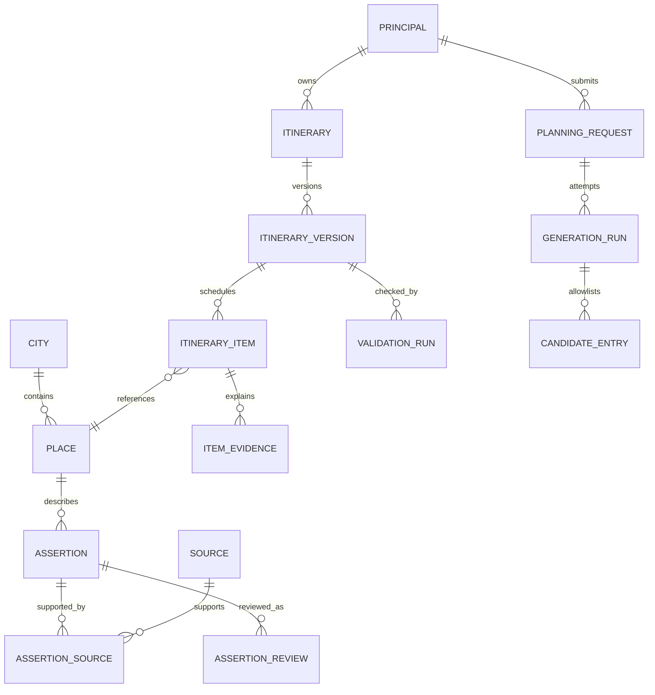

# Data model

Current execution: **E2 local development** is authorized under [E2-01](m1/DECISION_REGISTER.md#13-e2-local-development-authorization), following Product Owner acceptance of the E1 local checkpoint. Scope: explicit evidence-bound meal scheduling, honest day utilization, lossless compact recommendation input and local UI/regression verification. Complete ranking, PD-01–PD-04 and all ceilings remain. No live API calls or E3 progression. M1 remains OPEN; M2/production acceptance is not granted. Historical phase descriptions below are retained as history, not new permissions. See the [product audit](PRODUCT_AUDIT.md) and [README](../README.md) for actual execution evidence.

## E2 local schema direction

The local meal inventory adds an explicit scheduling choice. Unscheduled is the compatibility default; scheduled requests bind a synthetic service ID and traveler-confirmed time window, normalized to city-local minutes. Result meal rows distinguish unscheduled, scheduled and unresolved timing, with nullable resolved place/time/duration and immutable applicable evidence refs. Exact necessary/provided/prepaid/purchased reconciliation remains mandatory.

Synthetic service fixtures separately describe supported portions, duration, location, hours and suitability; they are not inferred from a cultural/food visit. A scheduled meal can share a qualifying venue visit without adding duplicate dwell or dropping budget rows. Service refs participate in current authority and withdrawal/revision checks. Additional service fees are separate group ledger rows; unknown fees remain null. Only required authoritative service fields are pinned. When an eligible service supplies suitability, unused generic allowance suitability refs are omitted while purchased-portion price evidence remains required. These are local runtime contracts, not a production migration or approved storage/retention model. Compact AI input retains preference/candidate semantics under a versioned projection; the original snapshot and assertion authority remain local and immutable.

Current scoped local additions under COMP-01/GEM-01,2026-10-23: runtime-only editorial snapshots contain revision, records, status, active/draft synthetic place bodies, contributor simulated ID, field eligibility issues and immutable ordered events. Events have ID/sequence/time/place/action/actor/note and always synthetic=true,independentlyReviewed=false. Baseline events are system fixtures, not fabricated reviews. Active publication survives a pending draft; approval rotates all immutable field heads; retired assertions/source revocations cannot be replayed. Shared current projections suppress withdrawn schedule/facts/totals while frozen private itinerary bodies remain unchanged. No database tables or production authentication/storage are created.

Gemini's server-only wire format contains only version,snapshot and complete candidate ID/reason rankings. Existing trusted categories/assertion references are hydrated from the original local snapshot and strictly revalidated. Metadata distinguishes mock,deterministic fallback and validated Gemini inference; only actual success may use Gemini AI — Live. The authorized single Free Tier attempt failed(local502/no validated response). An ignored exclusive local operational receipt survives restarts to prevent extra calls; it holds no key,request,traveler or reviewer data and is excluded from archives. This limited operation receipt is not approval of production guest retention/persistence. All real provider rights/privacy/human-review gates remain open. See [decisions](m1/DECISION_REGISTER.md#11-gemini-free-tier-demonstration-exception) and [execution evidence](../README.md#competition-finalization-results).

Planning baseline: 2026-10-22; authorization updated 2026-10-23. Planning direction is approved; [DEVB3-01](m1/DECISION_REGISTER.md#9-controlled-local-phase-b3-authorization) permits controlled local synthetic B3 AI recommendation readiness, following reported B2 review. Strict versioned ranking schemas, immutable fixture references, original candidate/evidence allowlists, mock adapters and temporary in-memory preferences/results/revisions are permitted; no real provider configuration, migrations, production persistence/retention adoption or real data are authorized. M1 remains OPEN and M2 acceptance is not granted. Read with [PRD](PRD.md), [Architecture](ARCHITECTURE.md), [Roadmap](ROADMAP.md) and [M1 contract decisions](m1/CONTRACT_DECISIONS.md). Examples describe shapes, not real Palembang venue records. Freshness, retention and review periods still need operational and rights approval.

Product Owner update, 2026-10-23: [PD-01–PD-04 product directions](m1/DECISION_REGISTER.md) are approved: confirmed daily necessary-meal inventory including partial days and exact provided/prepaid portions; retained walking/pace limits; trip-wide mandatory-category fulfillment; and PD-04 Option A preserving 1–7 days, five stops/day maximum, every hard requirement and existing operating ceiling. This approves product semantics only. Measurement/uncertainty/accessibility methods, real cultural taxonomy/overlaps/classifications, prices/allowances, physical storage, rights and actual human review remain pending. The logical shapes below do not select or provision the proposed volatile tier. Geoapify remains a candidate, paid embedded browser Maps stays disabled, live-test Stage B/C spending is unapproved, and M1 remains OPEN without M2 acceptance.

## Design rules

1. Canonical city and place UUIDs identify entities. Names, coordinates, search rankings, and provider place IDs do not establish identity by themselves. Expansion adds city records and catalogue coverage, not city-specific application tables.
2. Keep owned or lawfully licensed catalogue facts separate from provider content. In particular, a Google Maps response is not automatically eligible for the catalogue, evidence storage, analytics, or saved itinerary versions. Provider terms and the applicable regional agreement decide each field's storage and attribution policy.
3. Every user-facing factual field resolves to an immutable assertion, an authorized human review event, and one or more source records. The AI can select allowlisted IDs and claim references; it cannot create factual records.
4. `verified`, `estimated`, `unknown`, `stale`, and `conflicted` are distinct evidence states. Identity, opening hours, and historical claims never use `estimated`. Prices, dwell times, and travel durations may use explicitly labeled, reproducible estimates with adequate bounds and lawful inputs.
5. A version's recorded validation result is historical. Current usability is recomputed from latest validation, source eligibility, expiry, and revocation; an old `validated` result never overrides a current closure or revoked source.
6. Owner, city, and parent relationships have database-enforced foreign keys. UUID unpredictability is not authorization. Private data is inaccessible to public catalogue readers.

## Types, time, money, and identifiers

| Type | Contract |
| --- | --- |
| Identifier | Random UUID unless otherwise stated; no sequential public identifiers. `auth.users.id` is the account identity. |
| Timestamp | `timestamptz`, stored as an instant. Local dates use `date`; local schedule minutes use bounded integers. Half-open intervals `[start, end)` remove boundary ambiguity. |
| Time zone | `cities.time_zone` is a validated IANA identifier; Palembang's seed configuration will be `Asia/Jakarta`. Record `time_zone_snapshot` with each plan version. Never use the server time zone or assume all Indonesia shares one zone. |
| Money | The pilot deliberately stores `bigint` integer whole rupiah: one stored unit is one rupiah; subrupiah amounts are unsupported. This is the application's scale choice, not an ISO currency-exponent claim. No binary floats. Check nonnegative and a product-configured maximum; request budgets must be strictly positive. Serialize large integers as decimal strings; TypeScript boundaries must reject unsafe numbers. Future currencies require an explicit storage scale and reviewed rounding/conversion policy, never a shared hardcoded exponent. |
| Quantity | Bounded integer for people, vehicles, admissions, and menu quantities. Fractional quantity requires a separately reviewed unit conversion, not a float. |
| Location | PostGIS `geography(Point,4326)` with a lawful location assertion; GiST index. Accuracy and source are explicit. Missing or unverified location cannot support route feasibility. |
| Language | BCP 47 tag, initially `id-ID`; translation rows preserve the source claim and reviewer. |
| Structured JSON | Versioned JSON schemas, bounded sizes, no arbitrary provider payloads, prompt dumps, or hidden factual fields. Use relational columns for identity, ownership, money, time, and validation. |

All canonical tables have `created_at`; mutable administrative tables additionally have `updated_at`. These timestamp defaults are server-generated. All unique/composite keys mentioned below must exist before their foreign keys are introduced.

## Entity relationships

## Canonical catalogue and evidence

### Core tables

| Table | Columns and constraints |
| --- | --- |
| `cities` | `id uuid PK`, `slug text UNIQUE`, `country_code char(2)`, `display_name text`, `time_zone text`, `currency char(3)`, `coverage_status enum(pilot_ready, preparing, unavailable)`, `publication_state enum(draft, published, suspended)`, `created_at`, `updated_at`. Pilot country/currency are `ID`/`IDR`. A published city requires an approved coverage review; an empty city cannot be advertised as supported. |
| `places` | `id uuid PK`, `city_id uuid FK cities`, `kind enum(cultural_site, museum, historical_site, living_tradition, food_venue, market, experience)`, `publication_state enum(draft, published, suspended, retired)`, `current_identity_assertion_id uuid nullable`, `current_location_assertion_id uuid nullable`, `created_at`, `updated_at`; `UNIQUE(id, city_id)`. Publication is an administrative state, not verification by itself. |
| `place_provider_refs` | `id uuid PK`, `place_id uuid`, `city_id uuid`, `provider text`, `provider_place_id text`, `matched_by uuid FK auth.users`, `match_reviewed_at timestamptz`, `last_checked_at timestamptz nullable`, `use_policy_id uuid FK data_use_policies`, `retired_at timestamptz nullable`; composite FK `(place_id,city_id)` to `places`; unique active `(provider,provider_place_id)`. Provider ID storage/use still follows applicable terms. A match never imports the provider's factual fields automatically. |
| `place_access_points` | `id uuid PK`, `place_id uuid`, `city_id uuid`, `location_assertion_id uuid`, `review_event_id uuid`, `label text`, `access_point_kind enum(entrance, exit, pickup, dropoff)`, `publication_state enum(draft, published, suspended)`; composite place/city and matching location assertion/review FKs; `UNIQUE(id,place_id,city_id)`. Each point has independent lawful coordinate provenance and mode/access evidence. A venue centroid is not automatically an accessible entrance. |
| `sources` | `id uuid PK`, `source_kind enum(official_operator, government, institution, community_authority, licensed_dataset, field_observation, provider_api)`, `publisher text`, `title text`, `canonical_url text nullable`, `source_locator text nullable`, `use_policy_id uuid FK data_use_policies`, `access_class enum(public, internal, restricted)`, `fetched_at timestamptz nullable`, `observed_at timestamptz nullable`, `content_hash text nullable`, `lawful_excerpt text nullable`, `snapshot_object_key text nullable`, `retention_expires_at timestamptz nullable`, `revoked_at timestamptz nullable`, `revocation_reason text nullable`, `created_by uuid FK auth.users`, `created_at`. Require a URL or internal observation locator. Excerpts, hashes, and snapshots exist only where the policy explicitly permits them; a hash is not a substitute for permission. No unrestricted raw Maps payload column. |
| `data_use_policies` | `id uuid PK`, `provider_or_licensor text`, `agreement_reference text`, `agreement_version text`, `allowed_fields jsonb`, `allowed_purposes jsonb`, `persistence_class enum(independent_persistent, ephemeral, prohibited)`, `maximum_ttl_seconds integer nullable`, `attribution_text text nullable`, `attribution_url text nullable`, `approved_by uuid FK auth.users`, `approved_at timestamptz`, `review_due_at timestamptz`, `revoked_at timestamptz nullable`. New/unknown policy defaults to deny. Agreement changes create a new version, never silently widen an old policy. |
| `assertions` | `id uuid PK`, `place_id uuid`, `city_id uuid`, `kind enum(identity, location, historical_claim, opening_schedule, price, dietary, accessibility, dwell, cultural_etiquette, walking, interest_assignment)`, `field_key text`, `payload_schema_version integer`, `supersedes_assertion_id uuid nullable`, `created_by uuid FK auth.users`, `redacted_at timestamptz nullable`, `created_at`; composite FK `(place_id,city_id)` to `places`; `UNIQUE(id,place_id,city_id,kind)`. Typed payloads below are immutable except audited required erasure. An assertion cannot supersede a different place/field/kind. |
| `assertion_sources` | `assertion_id uuid FK assertions`, `source_id uuid FK sources`, `relationship enum(direct_support, corroboration, contradiction)`, `locator text`, `observed_at timestamptz nullable`, `PK(assertion_id,source_id,relationship)`. Locator identifies the relevant page, section, API field, or observation. Citation existence alone does not prove that it supports the claim. |
| `assertion_reviews` | `id uuid PK`, `assertion_id uuid FK assertions`, `state enum(verified, estimated, unknown, stale, conflicted)`, `reviewer_id uuid FK auth.users`, `review_sequence bigint`, `reviewed_at timestamptz`, `valid_from timestamptz`, `valid_until timestamptz`, `reason_code text`, `review_note text nullable`, `supersedes_review_id uuid nullable`, `created_at`; `UNIQUE(id,assertion_id)` and `UNIQUE(assertion_id,review_sequence)`; require `valid_until > valid_from`, authorized reviewer, and state appropriate to assertion kind. Rows append only; corrections append another event. Verified requires direct supporting evidence, a satisfied review checklist, and no unresolved material contradiction. |
| `catalogue_audit_events` | `id uuid PK`, `actor_id uuid nullable`, `action text`, `entity_type text`, `entity_id uuid`, `reason_code text`, `before_hash text nullable`, `after_hash text nullable`, `created_at`. Append only; no raw sensitive observation/prompt text. Review and publication events remain distinguishable. |

Authoritative selection uses `catalogue_field_heads` and ordered review chains, never a query for the newest verified record. Add `review_sequence bigint` to `assertion_reviews`, unique with `assertion_id`; each review has at most one successor, checked under a lock. A new current review, including unknown/conflicted/revoked evidence, cannot reveal an older verified predecessor. `supersedes_review_id` must belong to the same assertion and point to the immediately preceding sequence. Timestamps alone do not order concurrent events.

| Additional table | Contract |
| --- | --- |
| `catalogue_field_heads` | `place_id uuid`, `city_id uuid`, `field_key text`, `scope_key text`, `assertion_id uuid nullable`, `review_event_id uuid nullable`, `head_state enum(active, missing, withdrawn)`, `revision bigint`, `publication_revision bigint`, `selected_by uuid`, `selected_at timestamptz`; PK `(place_id,field_key,scope_key)`, composite place/city and assertion/place/city/review FKs. Active heads require an assertion and its current review. Missing/withdrawn heads may retain permitted tombstone refs but are never eligible. Scope distinguishes exact predicate, tariff component/eligibility, or effective schedule; ambiguity/overlap is not resolved by a convenient older value. |
| `field_head_events` | Append-only `id uuid PK`, head key and place/city FKs, `head_revision bigint`, `action enum(activate, change_review, withdraw, mark_missing)`, old/new permitted assertion/review refs, authorized actor, time and reason; unique `(place_id,field_key,scope_key,head_revision)`. Update head, review successor, publication revision and event atomically with expected-revision compare-and-swap. Human contribution approval is distinct from authorship; an authorized urgent withdrawal need not wait for a replacement approval. |

Unpublished draft assertions do not advance a field head. Activating a replacement, resolving a conflict, or recording a new authoritative review is an explicit authorized operation. A source revocation/expiry invalidates the selected head at read time even before a maintenance event updates it. For a requested date/eligibility, select applicable explicit scopes, then evaluate current review state, source rights/revocation, review freshness and travel-date applicability. No match is unknown; conflicting overlapping alternatives are conflicted until reviewed. Required cost components can legitimately have separate noncompeting scopes. No automatic fallback to a superseded assertion/review is allowed.

Identity/location pointers on `places` are constrained mirrors of their authoritative heads, not a second selection mechanism. They require composite typed assertion/review checks. Candidate snapshots and `version_evidence_dependencies` additionally pin field/scope, `head_revision`, `publication_revision`, assertion and review sequence. Recheck those exact revisions atomically at version commit; a race returns stale-evidence/revalidation, not a validated result from a superseded read. See the algorithm and test cases in M1 contract decisions.

The approved catalogue projection exposes stable IDs, lawful translated content, evidence state, freshness, permitted citations, and attribution. It omits internal notes, reviewer personal information, restricted locators, license contracts, unpublished observations, and provider payloads. A location/name/publication change cannot replace canonical identity silently. Potential duplicate merges retain aliases and an audit trail; conflicting entities remain unavailable until reviewed.

### Typed assertion payloads

Each table has `assertion_id uuid PK`, `place_id uuid`, `city_id uuid`, and a checked constant `kind` matching the parent assertion through `(assertion_id,place_id,city_id,kind)`. Exactly one matching payload table must exist per assertion at transaction commit. This is enforced through restricted write procedures and deferred database constraints, not application convention alone. Listed required factual fields are required for a nonredacted assertion. A restricted erasure procedure can mark `redacted_at` and replace its payload/translation children with a content-free typed tombstone when retention is unlawful; this audited exception to immutability immediately makes it ineligible everywhere. Normal writers cannot use redaction to edit history.

| Table | Additional payload columns and rules |
| --- | --- |
| `identity_facts` | `canonical_name text`, `entity_description text`, `operational_state enum(operating, temporarily_closed, permanently_closed, unknown)`. A recommendable identity needs current verified identity and an operating state suitable for the intended visit. No generated venue identity or inferred operating status. |
| `location_facts` | `position geography(Point,4326)`, `address_text text nullable`, `accuracy_meters integer nullable`, `entrance_note text nullable`; accuracy is nonnegative. Coordinates must have lawful persistent provenance; a provider match alone is insufficient. Large sites may later add entrance entities without changing the place ID. |
| `historical_claims` | `claim_key text`, `source_language text`, `claim_text text`, `claim_scope text`, `qualification text nullable`; a claim is atomic enough to review and cite. Contested accounts remain qualified or conflicted; confidence numbers cannot replace evidence. |
| `claim_translations` | `assertion_id uuid FK historical_claims`, `language_tag text`, `translated_text text`, `reviewer_id uuid FK auth.users`, `reviewed_at timestamptz`, `PK(assertion_id,language_tag)`. Translation is a reviewed rendering of the same claim, not a new uncited claim. Similar reviewed translations serve identity names, etiquette, and other prose through typed translation tables. |
| `opening_schedules` | `effective_from date`, `effective_through date nullable`, `time_zone text`, `reservation_requirement enum(required, not_required, unknown)`, `last_entry_offset_minutes integer nullable`. Valid date range, zone equals the applicable city zone, nonnegative offset. A reservation requirement can block a visit until booking availability is confirmed; this platform does not book. |
| `weekly_open_sessions` | `id uuid PK`, `assertion_id uuid FK opening_schedules`, `iso_weekday smallint`, `open_minute integer`, `close_minute integer`; weekday 1–7, start 0–1439, end greater than start and no greater than start+1440 (up to 2879). Multiple disjoint intervals represent split hours; 0–1440 represents 24 hours. Disallow overlapping effective sessions after overnight expansion. |
| `opening_date_exceptions` | `id uuid PK`, `assertion_id uuid FK opening_schedules`, `local_date date`, `override_kind enum(closed, replace, unknown)`, `reason_text text nullable`, `UNIQUE(assertion_id,local_date)`. Complete calendar-day override including any incoming overnight tail. Each exception inherits the schedule's evidence; contradictory exceptions require a new conflicted review. |
| `exception_open_sessions` | `id uuid PK`, `exception_id uuid FK opening_date_exceptions`, `open_minute integer`, `close_minute integer`; 0 <= start < end <= 1440. Only `replace` accepts sessions and requires at least one; `closed`/`unknown` accept none. An overnight exception is represented by dated intervals on both dates. |
| `price_facts` | `category enum(activity, food, local_transport)`, `label text`, `applies_from date`, `applies_through date nullable`, `day_scope enum(all_days, weekday, weekend, explicit_dates)`, `applicable_dates date[] nullable`, `lower_idr bigint nullable`, `upper_idr bigint nullable`, `unit enum(per_person, per_group, per_vehicle, per_item)`, `quantity_basis text`, `age_band enum(all, adult, child, other)`, `eligibility_rule text nullable`, `eligibility_spec jsonb`, `party_min smallint nullable`, `party_max smallint nullable`, `tax_inclusion enum(included, excluded_known, unknown)`, `tax_upper_idr bigint nullable`, `mandatory_fee_upper_idr bigint nullable`, `estimate_method_id uuid nullable FK estimate_methods`. Valid applicability dates; explicit dates are nonempty only for that scope. Eligibility uses a reviewed bounded schema, never executable expressions. Both bounds present or both absent; 0 <= lower <= upper; party limits coherent. A verified exact tariff has equal bounds; verified published ranges keep their range. An estimated range needs an approved method. Unknown mandatory charges prevent a bounded total. |
| `dietary_facts` | `property enum(vegetarian_option, vegan_option, halal_certified, halal_operator_statement, allergen_information_available)`, `answer enum(yes, no, unknown)`, `scope text`, `certifier text nullable`, `certificate_reference text nullable`, `certificate_expires_at timestamptz nullable`. Scope separates one dish, kitchen, menu, and whole venue. Certification and operator statement are separate predicates; a dish name, rating, or nearby mosque proves neither. Allergy suitability is not inferred from these rows. |
| `accessibility_facts` | `property enum(step_free_entry, step_free_route, accessible_toilet, seating_available, other)`, `answer enum(yes, no, unknown)`, `scope text`, `detail text nullable`. Partial accessibility remains scoped; no blanket accessibility label from a single feature. |
| `dwell_facts` | `minimum_minutes integer`, `typical_minutes integer`, `maximum_minutes integer`, `estimate_method_id uuid nullable FK estimate_methods`; 0 < minimum <= typical <= maximum. Pace selects within an approved range; scheduling must declare its selected duration and include buffers. |
| `walking_facts` | Typed assertion kind `walking`, with `scope enum(venue_interior, access_connector)`, applicable ingress/egress point IDs, `distance_lower_m integer`, `distance_upper_m integer`, `estimate_method_id uuid nullable`, applicability and lawful measurement evidence. Require 0 <= lower <= upper, reviewed scope and exact endpoint linkage. Missing is not zero. A distance assertion is not proof of step-free access or walking duration. Add `walking` to assertion kinds and estimate-method kinds. |
| `interest_categories` / `place_interest_assignments` | Stable category IDs/slugs and reviewed place/category assignment assertions (add `interest_assignment` kind), with taxonomy version, rationale and evidence references. Composite assignment/place/city/category FKs; use authoritative heads keyed by category scope. PD-03 approves trip-wide fulfillment semantics, while real category definitions, overlap rules and each place assignment remain pending independent cultural review. Editorial interest classification must not imply an official heritage designation. |
| `etiquette_facts` | `topic text`, `instruction_text text`, `applicability text`. Verified community/operator guidance; no invented dress codes, ritual access rules, or customs. |
| `estimate_methods` | `id uuid PK`, `version integer`, `kind enum(price, dwell, travel_buffer, walking)`, `name text`, `calculation_spec jsonb`, `input_requirements jsonb`, `approved_by uuid FK auth.users`, `approved_at timestamptz`, `valid_until timestamptz`, `use_policy_id uuid FK data_use_policies`, `UNIQUE(name,version)`. Calculation specifications are deterministic, reviewed and versioned; model guesses do not qualify. |

For effective hours, expand weekly sessions from the previous and current local service dates, intersect with the visit date, then replace that date's availability with any complete date exception. Union adjacent intervals and resolve overlaps; `closed` yields none and `unknown` yields no verified availability. The chosen visit and required dwell must fit within one effective continuous interval and last-entry rules. Date arithmetic uses the city's IANA zone and handles daylight-saving transitions for future cities. Ambiguous/nonexistent local times require an explicit resolution policy; they never silently use the server zone.

No hours assertion, an expired schedule, an unknown exception, or an unresolved holiday closure is missing availability. The place may appear in an unscheduled alternatives section, or in a clearly marked draft with an explicit blocker; it cannot appear in a validated time slot. A closed interval is a known conflict, not missing data. Reviewers must check date-specific applicability for the trip; recent weekly hours alone do not settle a known holiday exception.

### Freshness policy

Proposed maximum review ages: identity/location 180 days, historical claims 365 days, opening hours 7 days, prices 30 days, dietary/accessibility 30 days. These are upper bounds, not reliability guarantees. Review validity also ends at source/license expiry, certificate expiry, known change, event end, or explicit revocation, whichever comes first. Review freshness is evaluated at generation/read time; travel-date applicability is evaluated separately against the schedule or tariff's effective dates. A future itinerary may be provisionally validated against currently reviewed evidence whose published schedule covers that trip, then loses current validation when its evidence expires and needs refreshing. Date exceptions require applicable current-date evidence; a past year's festival or holiday schedule cannot be reused automatically. An estimate cannot outlive its method or any required input. Freshness policy is versioned and recorded on each validation run.

## Traveler ownership and inputs

| Table | Columns and constraints |
| --- | --- |
| `principals` | `id uuid PK`, `kind enum(account, guest)`, `auth_user_id uuid UNIQUE nullable FK auth.users`, `guest_token_hash text UNIQUE nullable`, `expires_at timestamptz nullable`, `created_at`; exactly the account or guest identity corresponding to kind. Guest token is random, stored hashed, delivered through a secure HttpOnly session mechanism. Guest has a 24-hour maximum lifetime, not a sliding indefinite session. |
| `profiles` | `user_id uuid PK FK auth.users`, `display_name text nullable`, `ui_language text default id-ID`, `created_at`, `updated_at`. Avoid storing sensitive travel preferences here by default. |
| `preference_profiles` | `id uuid PK`, `principal_id uuid FK principals`, `label text`, `interests text[]`, `food_preferences text[]`, `transport_mode enum(walking, private_car, taxi_ride_hail)`, `pace enum(relaxed, balanced, active)`, `consented_at timestamptz`, `expires_at timestamptz nullable`, `created_at`, `updated_at`. Optional later extension, account-only and opt-in; reusable profiles are not required for the MVP journey. Explicit accessibility or food restrictions may reveal sensitive information; never infer religion, medical conditions, ethnicity, or disabilities. |
| `planning_requests` | `id uuid PK`, `principal_id uuid FK principals`, `city_id uuid FK cities`, `start_date date`, `end_date date`, `party_size smallint`, `adult_count smallint nullable`, `child_count smallint nullable`, `budget_total_idr bigint`, `currency char(3)`, `interests text[]`, `food_preferences text[]`, `hard_food_requirements text[]`, `accessibility_requirements text[]`, `allow_repeat_culinary_venues boolean default false`, `repeat_preference_confirmed_at timestamptz nullable`, `transport_mode enum(walking, private_car, taxi_ride_hail)`, `pace enum(relaxed, balanced, active)`, `locale text`, `input_schema_version integer`, `created_at`, `expires_at timestamptz nullable`; `UNIQUE(id,principal_id,city_id)`. Immutable normalized input. Both party counts present and sum to party size, or both absent; no birth dates. Repeated culinary venues require explicit configured user preference; cultural venues do not repeat across the trip. |
| `request_day_windows` | `request_id uuid FK planning_requests`, `local_date date`, `start_minute integer`, `end_minute integer`, `PK(request_id,local_date)`; one within-day window per travel day for pilot, 0 <= start < end <= 1440. Explicitly document application defaults before generation. |
| `request_day_policies` | `request_id uuid FK planning_requests`, `local_date date`, `cultural_optout boolean default false`, `culinary_optout boolean default false`, `free_day boolean default false`, `user_override_confirmed_at timestamptz nullable`, `coverage_policy_version text`, `meal_policy_version text`, `PK(request_id,local_date)`. Nondefault flags require an explicit user action; the AI or repair engine cannot opt out. Otherwise minimum one scheduled cultural and one scheduled culinary stop per day. A free day waives stop coverage, not undisclosed meal/transport costs. |
| `request_meal_requirements` | `id uuid PK`, `request_id uuid FK planning_requests`, `local_date date`, `meal_kind enum(breakfast, lunch, dinner, snack, custom)`, `meal_sequence smallint`, `required_party_slots smallint[]`, `coverage_choice enum(scheduled_venue, budget_allowance)`, `inventory_confirmed_at timestamptz`, `meal_policy_version text`, `UNIQUE(request_id,local_date,meal_sequence)`. PD-01: confirm a complete daily necessary-meal inventory including partial arrival/departure days and unscheduled meals. Suggested breakfast/lunch/dinner rows support actual necessary inventory confirmation; activity windows do not automatically omit meals. Party slots are anonymous indices 1..party_size, not names. No generic meal exclusion or removal of an acknowledged necessary occasion is allowed; exact provided/prepaid portions use the separate table below. Unconfirmed inventory cannot pass budget validation. |
| `request_meal_exemptions` | `id uuid PK`, `meal_requirement_id uuid FK request_meal_requirements`, request/owner/date binding, `basis enum(traveler_provided, prepaid)`, `party_slots smallint[]`, `declaration text`, `confirmed_at timestamptz`, `request_revision integer`. Exempt slots must be nonempty subsets of required slots and cannot overlap another exemption for that meal. Only documented provided/prepaid portions leave the incremental budget; taxes, drinks or other remaining necessary purchases still need bounded included costs. Do not collect receipts or personal identities for this declaration. |
| `request_mandatory_interests` | `request_id uuid FK planning_requests`, `category_id uuid FK interest_categories`, `scope enum(trip)` default trip, `minimum_distinct_visits smallint` fixed 1 in MVP, `confirmed_at timestamptz`, PK `(request_id,category_id)`. Categories must be active for the city; changing/removing a requirement needs an explicit new request. Soft `interests` cannot override these rows. |
| `request_walking_limits` | `request_id uuid`, `local_date date`, `maximum_m integer`, `pace_policy_version text`, `confirmed_at timestamptz`, PK `(request_id,local_date)` with request/day binding. PD-02 retains 2,000/4,000/8,000 meters per traveler/day for relaxed/balanced/active and pace stop caps 3/4/5, reducible by user. Common group route must fit the strictest declared traveler limit; no multiplication by party size. Measurement methodology, uncertainty bounds and accessibility suitability still need competent human review; this input row does not certify them. |
| `request_day_anchors` | `id uuid PK`, `request_id uuid FK planning_requests`, `local_date date`, `anchor_role enum(start, end)`, `anchor_state enum(active, expired, redacted)`, `access_point_id uuid nullable FK place_access_points`, `user_position geography(Point,4326) nullable`, `precision_meters integer nullable`, `storage_consent boolean`, `expires_at timestamptz nullable`, `UNIQUE(request_id,local_date,anchor_role)`. Active rows require exactly one lawful canonical access point or user-selected point/area anchor; expired/redacted tombstones may have neither and retain no precise coordinates or reconstructable hash. Require explicit active start and end each day for generation, including return travel. A coarse area anchor discloses its routing assumption. Exact user location is optional and short-lived; do not retain home addresses in logs. |

Validate inputs before accepting generation using city-local `today`: 1–7 inclusive calendar days, start today through today+90 days inclusive, end no later than today+90, party 1–8, strictly positive bounded group budget, supported city, supported enumerations, and complete daily windows, coverage/meal choices, and active start/end anchors. An incomplete saved draft may preserve a content-free expired anchor but cannot pass generation/validation until the user replaces it. MVP modes are walking, private car, and taxi/ride-hail, subject to supported route evidence; do not silently fall back to motorcycle or public transport. The same constraints run again before generation because queued requests can become invalid with time. Budget covers activities, meals, and local transport for the entire party; accommodation and intercity travel are excluded and stated in every cost summary. No silent per-person reinterpretation. Child counts can be omitted; tariff selection must then use a disclosed applicable conservative rule or flag unavailable costing, not invent age eligibility.

Hard dietary/accessibility filters require matching, current, scoped affirmative evidence; unknown never counts as yes. Soft preferences affect ranking and can remain unsatisfied with an explanation. Free text is optional, size-limited, treated as untrusted input, and never allowed to override these requirements.

## Itineraries, immutability, and revalidation

| Table | Columns and constraints |
| --- | --- |
| `itineraries` | `id uuid PK`, `principal_id uuid FK principals`, `city_id uuid FK cities`, `title text`, `current_version_id uuid nullable`, `last_valid_version_id uuid nullable`, `revision bigint`, `saved_at timestamptz nullable`, `deleted_at timestamptz nullable`, `expires_at timestamptz nullable`, `created_at`, `updated_at`; `UNIQUE(id,principal_id,city_id)`. Composite FKs `(current_version_id,id,principal_id,city_id)` and `(last_valid_version_id,id,principal_id,city_id)` target `(id,itinerary_id,principal_id,city_id)` in versions, checked at commit. Guest rows expire in 24 hours; `saved_at` is permitted only for an account principal. No public sharing/token field in MVP. Last-valid records a historical passing revision, not proof of current validity after evidence expiry. |
| `itinerary_versions` | `id uuid PK`, `itinerary_id uuid`, `principal_id uuid`, `city_id uuid`, `version_no integer`, `base_version_id uuid nullable`, `request_id uuid`, `time_zone_snapshot text`, `created_by_kind enum(user, planner, restore)`, `feasibility_status_at_creation enum(validated, draft, blocked)`, `schema_version integer`, `content_hash text`, `redacted_at timestamptz nullable`, `created_at`; composite FK `(itinerary_id,principal_id,city_id)` to itineraries and `(request_id,principal_id,city_id)` to requests; `UNIQUE(itinerary_id,version_no)` and `UNIQUE(id,itinerary_id,principal_id,city_id)`. Base/current pointers must belong to the same itinerary through composite FKs. Version bodies never update in normal editing; audited required erasure may remove restricted content, set redaction, and invalidate the historical hash/validation. Redacted versions cannot restore restricted content. |
| `itinerary_days` | `id uuid PK`, `version_id uuid`, `itinerary_id uuid`, `principal_id uuid`, `city_id uuid`, `local_date date`, `day_number smallint`; composite FK to versions; `UNIQUE(version_id,local_date)`, `UNIQUE(version_id,day_number)`, and composite unique key including id and ownership. Exactly the requested local travel dates. |
| `logical_stops` | `id uuid PK`, `itinerary_id uuid`, `principal_id uuid`, `city_id uuid`, `created_at`; composite itinerary/owner/city FK and `UNIQUE(id,itinerary_id,principal_id,city_id)`. Stable logical identity for one user-visible stop across versions; a removed stop retains lawful lineage until private-plan deletion. |
| `itinerary_day_anchors` | `id uuid PK`, `day_id uuid`, `version_id uuid`, `principal_id uuid`, `city_id uuid`, `request_anchor_id uuid FK request_day_anchors`, `anchor_role enum(start, end)`, `anchor_state enum(active, expired, redacted)`, `access_point_id uuid nullable FK place_access_points`, `permitted_position geography(Point,4326) nullable`, `location_reference_hash text nullable`, `expires_at timestamptz nullable`, `UNIQUE(day_id,anchor_role)`; composite day/version/owner/city FK and request/date ownership binding. Active rows resolve exactly one lawful canonical or user-coordinate endpoint; expired/redacted tombstones allow neither and no precise hash. User precision/retention propagates. A saved coarse anchor cannot silently reuse a purged exact position; expiration invalidates dependent legs and purges prohibited coordinates, precise hashes and derived durations. |
| `itinerary_items` | `id uuid PK`, `logical_stop_id uuid`, `day_id uuid`, `version_id uuid`, `itinerary_id uuid`, `principal_id uuid`, `city_id uuid`, `place_id uuid`, `ingress_access_point_id uuid nullable`, `egress_access_point_id uuid nullable`, `sequence integer`, `item_kind enum(visit, meal, unscheduled_alternative)`, `start_at timestamptz nullable`, `end_at timestamptz nullable`, `dwell_minutes integer nullable`, `reason_codes text[]`, `schedule_state enum(scheduled, unscheduled, blocked)`; composite FK to day/ownership, logical-stop/itinerary/owner/city, and `(place_id,city_id)` to places; ingress/egress composite FKs to access points for that exact place/city; unique `(day_id,sequence)` and `(version_id,logical_stop_id)`. Scheduled rows require bounded start/end, dwell and eligible route access points; unscheduled alternatives have no promised slot. Rest buffers are separate timeline intervals, not invented place identities. |
| `itinerary_item_locks` | `item_id uuid PK`, `version_id uuid`, `itinerary_id uuid`, `principal_id uuid`, `city_id uuid`, `lock_place boolean`, `lock_order boolean`, `locked_sequence integer nullable`, `locked_start_at timestamptz nullable`, `locked_dwell_minutes integer nullable`, `confirmed_by_principal_id uuid`, `confirmed_at timestamptz`; composite item/version/itinerary/owner/city FK and confirming principal equals owner. At least one lock is active. Place lock preserves that canonical place; order lock preserves its exact displayed daily sequence; time lock preserves start instant; duration lock preserves dwell. Values match the source version. Copy user intent and locks into proposed versions with an audited source-item mapping; a conflict yields blocked until the user explicitly unlocks/changes it, never AI relaxation. |
| `item_lock_events` | `id uuid PK`, `logical_stop_id uuid`, `itinerary_id uuid`, `principal_id uuid`, `city_id uuid`, `version_id uuid`, `action enum(lock, unlock, change)`, `lock_kind enum(place, order, start_time, duration)`, `bounded_value jsonb nullable`, `confirmed_at timestamptz`; append only, composite logical-stop and version ownership FKs, actor is authenticated owner or its bound guest session. Copies preserve logical-stop identity and derive the new version's lock state from explicit events; AI/worker cannot author an unlock or change intent. |
| `item_evidence` | `item_id uuid FK itinerary_items`, `field_role enum(identity, location, history, hours, price, dietary, accessibility, dwell, etiquette)`, `assertion_id uuid FK assertions`, `review_event_id uuid`, `rendered_claim_key text nullable`, `PK(item_id,field_role,assertion_id)`; composite FK `(review_event_id,assertion_id)` to reviews. Place/city must match item. Stores references plus permitted independent snapshots in typed owned content only; no arbitrary provider strings. |
| `cost_lines` | `id uuid PK`, `version_id uuid`, `day_id uuid`, `item_id uuid nullable`, `meal_requirement_id uuid nullable FK request_meal_requirements`, `principal_id uuid`, `city_id uuid`, `category enum(activity, food, local_transport)`, `price_assertion_id uuid nullable`, `estimate_method_id uuid nullable`, `unit text`, `quantity integer`, `lower_total_idr bigint nullable`, `upper_total_idr bigint nullable`, `included_in_budget boolean`, `calculation_inputs jsonb`, `label_state enum(verified, estimated, unknown)`, `assumption_text text nullable`; composite version/day/item ownership FKs and request/date binding for meals. Immutable reproducible arithmetic, explicitly includes tax/mandatory charges. Every required meal has fully priced lines, whether scheduled at a venue or represented as a reviewed deterministic allowance with `item_id` null; included allowances cannot be dropped from the budget. Necessary food can leave the incremental budget only through documented provided/prepaid exemptions; required activity/transport lines stay included. Unknown upper bound never represented as zero. |
| `itinerary_meal_coverage` | `version_id uuid`, `meal_requirement_id uuid FK request_meal_requirements`, `day_id uuid`, `scheduled_item_id uuid nullable`, `coverage_state enum(scheduled, allowance, exempt, mixed, unknown)`, included/exempt anonymous party-slot sets and exemption refs, PK `(version_id,meal_requirement_id)`; composite owner/day/item/input FKs. Each required slot is covered exactly once by bounded included cost or a provided/prepaid declaration. Partial exemption leaves the remainder budgeted. Missing/overlapping portions invalidate coverage. Optional culinary alternatives do not replace necessary meal coverage. |
| `itinerary_walking_components` | `id uuid PK`, version/day/owner/city FKs, `occurrence_id uuid`, `segment_key text`, `kind enum(walking_leg, venue_interior, access_connector, transfer, anchor_connector)`, item/leg refs, assertion/review or permitted route-observation ref, `lower_m integer nullable`, `upper_m integer nullable`, `state enum(verified, estimated, unknown, stale, conflicted)`, policy and source-use refs. Unique `(version_id,occurrence_id,segment_key)` prevents counting a covered span twice within an occurrence. Repeated physical travel is a new occurrence. Missing required upper bound propagates to unknown daily walking; provider-derived meters persist only under approved rights. |
| `itinerary_interest_coverage` | `version_id uuid`, `request_id uuid`, `category_id uuid`, `item_id uuid`, assignment assertion/review/head revision, composite same-owner/city/request FKs. PD-03: at least one eligible scheduled visit across the trip satisfies each mandatory category; count distinct scheduled venues within each category, never unscheduled alternatives or unreviewed AI tags. A multi-category venue needs an eligible independently reviewed assignment for every category it covers, under the still-pending reviewed taxonomy/overlap policy. There is no requirement for a different venue for every category. |
| `cost_summaries` | `version_id uuid PK FK itinerary_versions`, `subtotal_lower_idr bigint nullable`, `subtotal_upper_idr bigint nullable`, `contingency_basis_points integer default 1000`, `contingency_upper_idr bigint nullable`, `total_upper_idr bigint nullable`, `calculation_policy_version text`. Sum all included group costs, add 10% contingency with integer rounding upward, and compare the upper total to budget. Any unknown required cost propagates to unknown total. |
| `route_legs` | `id uuid PK`, `version_id uuid`, `day_id uuid`, `principal_id uuid`, `city_id uuid`, `sequence integer`, `from_item_id uuid nullable`, `from_anchor_id uuid nullable`, `to_item_id uuid nullable`, `to_anchor_id uuid nullable`, `mode enum(walking, private_car, taxi_ride_hail)`, `departure_at timestamptz`, `route_observation_id uuid nullable`, `permitted_duration_upper_minutes integer nullable`, `buffer_minutes integer`, `leg_state enum(available, unavailable, expired)`, `attribution_policy_id uuid nullable`; exactly one item or anchor at each endpoint, with all endpoint composite FKs bound to the same day/version/owner/city. Item origins use the egress point and destinations the ingress point. Require start anchor -> first stop, adjacent stop legs, and final stop -> end anchor; a free day has an explicitly declared no-travel choice or applicable anchor travel. Persist duration/route details only if policy permits; otherwise keep lawful references and recalculate transiently. No copied geometry or navigation text by default. |
| `route_observations` | `id uuid PK`, `principal_id uuid FK principals`, `city_id uuid FK cities`, `provider text`, `policy_id uuid FK data_use_policies`, `origin_access_point_id uuid nullable FK place_access_points`, `origin_anchor_id uuid nullable FK itinerary_day_anchors`, `destination_access_point_id uuid nullable FK place_access_points`, `destination_anchor_id uuid nullable FK itinerary_day_anchors`, `observation_state enum(active, expired, redacted)`, `origin_location_revision_hash text nullable`, `destination_location_revision_hash text nullable`, `mode enum(walking, private_car, taxi_ride_hail)`, `requested_departure_at timestamptz`, `departure_bucket_start timestamptz`, `departure_bucket_end timestamptz`, `departure_policy_version text`, `route_identity_hash text nullable`, `observed_at timestamptz`, `expires_at timestamptz`, `storage_class enum(ephemeral, persistent_allowed)`, `transient_object_key text nullable`, `independent_estimate_method_id uuid nullable`; active observations require exactly one access point or anchor per endpoint, same city and lawful precise location revision, ownership-bound to the leg. Expired/redacted observations permit content-free endpoint tombstones and purge restricted payloads, precise hashes and derived durations; they cannot support routing. Route identity binds exact origin and destination entrance/access points in direction, mode, departure/time bucket, provider/policy and location evidence revisions. Bucket reuse requires a reviewed provider/mode timing policy and unexpired evidence; never reuse the reverse direction or a venue centroid route. Stored fields, identifiers, TTL and derived values are policy-specific; a reference alone is not permission to retain a result. Purging preserves only a permitted tombstone/audit ID. |
| `validation_runs` | `id uuid PK`, `version_id uuid FK itinerary_versions`, `validator_version text`, `freshness_policy_version text`, `evaluated_at timestamptz`, `valid_until timestamptz`, `status enum(validated, draft, blocked)`, `bounded_total_upper_idr bigint nullable`, `budget_idr bigint`, `route_evidence_set_hash text nullable`, `evidence_set_hash text`, `created_at`. Append only, with current result derived from latest eligible run. |
| `validation_findings` | `id uuid PK`, `validation_run_id uuid FK validation_runs`, `item_id uuid nullable FK itinerary_items`, `constraint_code text`, `severity enum(blocker, missing_evidence, warning)`, `observed_value jsonb nullable`, `expected_value jsonb nullable`, `safe_user_message text`. Bounded typed values without raw input/provider payloads. |
| `version_evidence_dependencies` | `version_id uuid FK itinerary_versions`, `assertion_id uuid FK assertions`, `review_event_id uuid`, `source_id uuid FK sources`, `policy_id uuid FK data_use_policies`, `PK(version_id,assertion_id,review_event_id,source_id)`; exact reviewed dependency set used for invalidation, not just rendered citations. |

`validated` means the full scheduled plan satisfies all hard constraints against declared evidence and conservative estimate bounds: correct city/dates/party, unique appropriate identities, applicable opening intervals/reservations, dwell, nonoverlap, transport legs and buffers, scoped mandatory preferences, daily coverage and complete meal allowances, and upper-bound group total including contingency <= budget. Each day includes at least one cultural and one culinary scheduled stop unless the user explicitly opted out of that category or chose a free day; repair cannot satisfy feasibility by deleting the trip's substance. It is not a guarantee against real-world change. `draft` means required evidence is missing or stale, so feasibility is unproven; `blocked` means a known hard conflict exists. If both occur, `blocked` takes precedence. Unscheduled activity alternatives do not satisfy required scheduled stops and their optional costs are excluded with that exclusion labeled. Required meals remain budgeted even when no venue is scheduled, using a labeled reviewed deterministic allowance; an unknown meal/transport/ticket bound prevents validation.

Revocation, closure, identity conflict, policy expiry, tariff change, or a fresh route failure immediately invalidates eligible current read results through the dependency join. Suppress revoked factual text, affected direction links, and invalid provider content in every current presentation, even for an immutable historic version; display a safe unavailable/refresh message. Purge affected public/private projections and cache entries immediately, then queue bounded revalidation; do not wait for a batch job to stop displaying `validated`. Preserve only lawful audit references/tombstones under restricted access, never revoked content in a normal historical view. Historical versions may remain readable with unavailable fields and outdated status; they cannot be exported as currently validated without revalidation.

Moving a visit, changing its access point, mode, or departure time invalidates downstream route bindings unless the exact directed endpoints and new timing remain within the explicitly supported unexpired bucket policy. Recompute the affected chain and rerun hours, travel, pace, meal and budget checks. Every paid preview/edit/revalidation uses the shared operation admission and caps below; a cap failure leaves the proposed version draft/blocked and preserves the prior valid revision, rather than reusing a mismatched route.

Google-dependent values must not leak into permanent version fields, copies, exports, logs, backups, or derived snapshots merely because the version is immutable. Legal review must determine whether the proposed saved schedule/cost derivations are eligible. If not, use independent lawful evidence for the persistent plan and recalculate restricted presentation data per view; disable persistence of unsupported derivatives until resolved.

### Edit concurrency

The B2 implementation models this contract only in temporary memory: session/revision/preview IDs, stable logical stop IDs, frozen input/intent/result/evidence snapshots, parent/revert provenance and a historical last-valid pointer. One operation owns a busy lock; base/preview identity is checked again at commit and current evidence is checked without another route operation. Current read projections suppress withdrawn data without editing the frozen historical body. A local lock fixes place/date/index/start/dwell together. Local revert restores choices/order under current inputs/meal inventory/locks, not an old budget or requirement set. Dates/party changes require an explicit new lineage. This is neither a migration nor proof of the transactions/RLS/ownership described next.

Create every edit as a new immutable version and validation result. In one transaction, compare the submitted `base_version_id` and itinerary `revision`, insert the new version, and advance `current_version_id` with a revision increment; a passing version may also update `last_valid_version_id`. Its pointer never bypasses append-only current validation history and expiry checks. A mismatch returns a conflict with the latest version and preserves both users' work; it never silently overwrites. Use a row lock or compare-and-swap predicate, unique version numbers, and request idempotency keys. Editing a hard requirement creates a new immutable `planning_request`; schedule-only edits may reference the existing input. Place, order, start-time and dwell locks persist as user intent in each proposed version; no model or repair path can remove them. Save/restore copies the lawful version into the same owner's lineage and revalidates.

`guest_plan_claims(id uuid PK, city_id uuid FK cities, guest_itinerary_id uuid UNIQUE, guest_principal_id uuid, account_principal_id uuid, account_itinerary_id uuid nullable, state enum(reserved, consumed, failed), reserved_at timestamptz, consumed_at timestamptz nullable, expires_at timestamptz)` is private. Composite ownership/city FKs bind guest and account plan mappings and roles; the account principal must match the authenticated user. Atomically lock the unexpired guest plan, reserve its unique claim, clone eligible graph rows into a new account lineage/new request, and mark consumed. Idempotent retry by that account returns its same mapping; a second account cannot replay the guest token to claim it. Claim metadata expires with the original guest deadline once no retry/deletion requirement remains; an absent/deleted guest plan is never claimable.

Guest claiming does not transfer a principal or extend guest raw-data retention. Before saving, replace precise short-lived anchors with explicitly confirmed coarse/canonical anchors in the new request and revalidate. If confirmation is absent, copy only a content-free expired anchor and save a draft requiring replacement; never clone precise coordinates, precise hashes or route-derived durations to evade expiry. A source/anchor erasure can invalidate and redact dependent version content despite normal editing immutability.

## AI runs, provider work, and cost controls

**B3 runtime-only boundary:** version recommendation requests/responses separately from catalogue, planner and revision schemas. A request binds the original current city-specific candidate snapshot and normalized structured preferences. A response accepts only bounded unique candidate IDs, exact permitted assertion references, existing eligible category references and controlled reason codes with checked preconditions; reject additional factual/narrative fields. Do not let model-returned categories mutate catalogue assignments. Mandatory-category representation in ranking is checked against source assignments, while actual scheduled trip-wide fulfillment remains the deterministic planner's responsibility. Recheck current evidence after ranking, on editing and before commit; preserve original snapshot membership even if the catalogue changes. No new candidate may enter through repair/fallback without a new validated operation boundary.

Recommendation metadata distinguishes simulated AI, deterministic fallback, sanitized rejection/availability reasons and versioned algorithm/schema policies. Ranking IDs accept only bounded canonical alphanumeric/colon/underscore/hyphen identifiers; source prose is never an ID. Requests reject duplicate candidates, categories, assertions, dates and food tags before deterministic fallback can amplify duplicate scores or references. External source identifiers need a reviewed canonical mapping at any future ingestion boundary. All factual rendering resolves independently approved claims and immutable evidence; the synthetic preview labels fixture assertions as unreviewed. Mock admission/token/cost outcomes are simulation metadata, not real spend records or provider receipts. B2 immutable committed bodies, current projections and locks remain authoritative; recommendation metadata cannot rewrite a revision or authorize a silent swap. These local contracts do not create the production tables below.

| Table | Columns and constraints |
| --- | --- |
| `metered_operations` | `id uuid PK`, `context_kind enum(traveler, system)`, `principal_id uuid nullable FK principals`, `city_id uuid nullable FK cities`, `operation_kind enum(generate, edit_preview, revalidate, catalogue_refresh, map_usage, other_approved)`, `run_id uuid UNIQUE nullable FK generation_runs`, `subject_key text`, `idempotency_key text`, `request_hash text`, `state enum(admitted, running, succeeded, failed, cancelled)`, `limits_policy_version text`, `rate_policy_version text`, `deadline_at timestamptz`, `created_at`, `finished_at timestamptz nullable`, `UNIQUE(context_kind,subject_key,operation_kind,idempotency_key)`. Traveler context requires its principal and matching run; system context requires an authorized system subject and no fabricated traveler request. A run has at most one associated metered operation, checked atomically/deferred. All server-controlled provider work reserves project spend here, including editorial refreshes without a traveler run. |
| `generation_runs` | `id uuid PK`, `request_id uuid`, `principal_id uuid`, `city_id uuid`, `operation_kind enum(generate, edit_preview, revalidate)`, `base_version_id uuid nullable`, `idempotency_key text`, `state enum(queued, running, succeeded, failed, cancelled)`, `phase enum(retrieval, selection, routing, scheduling, validation, persistence)`, `attempt integer`, `lease_owner text nullable`, `lease_until timestamptz nullable`, `cancel_requested_at timestamptz nullable`, `deadline_at timestamptz`, `result_version_id uuid nullable`, `result_validation_run_id uuid nullable FK validation_runs`, `error_code text nullable`, `model_id text nullable`, `prompt_version text nullable`, `limits_policy_version text`, `catalogue_snapshot_id uuid nullable FK candidate_snapshots`, `started_at timestamptz nullable`, `finished_at timestamptz nullable`, `expires_at timestamptz nullable`, `created_at`; composite request ownership/city FK and optional base/result version ownership/city FKs; `UNIQUE(principal_id,operation_kind,idempotency_key)`. Despite the provisional name this is the shared planning-operation ledger, not generation-only admission; final migration naming may use `planning_operations`. Edits/revalidation bind an authorized base version; every provider-using preview/change/refresh goes through the same ledger and reservations. Snapshot may be absent while queued/retrieving or for a no-model operation; selection requires a current matching-city snapshot. Same key with different normalized input hash is rejected. Success binds an owned result/report; `succeeded` does not imply itinerary status `validated`. |
| `candidate_snapshots` | `id uuid PK`, `city_id uuid FK cities`, `selection_policy_version text`, `created_at timestamptz`, `expires_at timestamptz`, `content_hash text`. Contains only eligible independent data/reference metadata, not unrestricted provider snapshots. |
| `candidate_entries` | `snapshot_id uuid FK candidate_snapshots`, `place_id uuid`, `city_id uuid`, `identity_assertion_id uuid`, `identity_review_id uuid`, `allowed_claim_ids uuid[]`, `allowed_reason_codes text[]`, `PK(snapshot_id,place_id)`; composite place/city and assertion-review FKs. Snapshot city must match run/request city. Other exact assertion/review dependencies use a relational `candidate_entry_evidence` join. Arrays are allowlists, not fabricated claims. |
| `candidate_entry_evidence` | `snapshot_id uuid`, `place_id uuid`, `assertion_id uuid FK assertions`, `review_event_id uuid`, `PK(snapshot_id,place_id,assertion_id)`; composite entry and assertion/review FKs. Records the precise evidence presented to selection. |
| `provider_attempts` | `id uuid PK`, `metered_operation_id uuid FK metered_operations`, `provider text`, `operation text`, `attempt_number integer`, `provider_request_id text nullable`, `started_at timestamptz`, `finished_at timestamptz nullable`, `outcome enum(in_flight, success, retryable_error, final_error, uncertain)`, `usage_input_tokens integer nullable`, `usage_output_tokens integer nullable`, `matrix_origin_count integer nullable`, `matrix_destination_count integer nullable`, `billable_units integer nullable`, `rate_policy_version text`, `reserved_cost_microusd bigint`, `actual_cost_microusd bigint nullable`, `error_code text nullable`. Reach the optional traveler run through its metered operation, never require a fake request for system work. Reserve/count every retry against that operation, with matrix elements = origin x destination and distinct SKU rates. Record cost in integer micro-USD separately from traveler IDR. Never log authorization headers, keys, quota secrets, full prompts, user coordinates, or complete API responses. |
| `quota_buckets` | `id uuid PK`, `subject_kind enum(account, guest, network)`, `subject_digest text`, `metric enum(paid_planning_operations, active_operations, provider_units)`, `window_start timestamptz`, `window_end timestamptz`, `limit_units bigint`, `used_units bigint`, `reserved_units bigint`, `UNIQUE(subject_kind,subject_digest,metric,window_start)`; all counts nonnegative and used+reserved <= limit. Initial combined paid-planning allowance is guest 3/24h/session and account 10/24h across generation, paid edit previews and paid revalidation together; one active operation per account. The rolling window is enforced through timestamped planning admissions below; apply network-risk controls across guest/account paths. Network digests are keyed HMACs with rotation/version and short expiry, not raw IPs or stable cross-window tracking IDs. |
| `planning_admissions` | `id uuid PK`, `principal_id uuid FK principals`, `metered_operation_id uuid UNIQUE FK metered_operations`, `operation_kind enum(generate, edit_preview, revalidate)`, `admitted_at timestamptz`, `provider_dispatched_at timestamptz nullable`, `released_before_dispatch_at timestamptz nullable`; timestamped source of truth for combined rolling 24-hour traveler allowance. Serialize admission with a principal-scoped database lock, count admitted nonreleased operations in `(now-24h,now]`, include in-flight reservations, check the active-operation limit and insert/reserve in one transaction. Fixed buckets may accelerate reporting but cannot implement the rolling allowance by themselves. A retry with the same idempotent operation consumes no additional admission; dispatched/uncertain paid work is not refunded automatically. |
| `spend_reservations` | `id uuid PK`, `metered_operation_id uuid FK metered_operations`, `budget_scope text`, `reserved_microusd bigint`, `settled_microusd bigint nullable`, `state enum(reserved, settled, released, uncertain)`, `expires_at timestamptz`, `created_at`; idempotent unique reservation per operation/scope. Global/provider limits apply to all metered operations, and account/guest limits additionally apply to traveler context. Reserve atomically before dispatch; uncertain provider outcomes retain a conservative charge until reconciled. |
| `idempotency_records` | `principal_id uuid FK principals`, `operation text`, `idempotency_key text`, `request_hash text`, `resource_id uuid nullable`, `state enum(in_progress, completed, failed)`, `expires_at timestamptz`, `PK(principal_id,operation,idempotency_key)`. Values contain resource references and safe error codes only. |
| `outbox_events` | `id uuid PK`, `event_type text`, `aggregate_id uuid`, `dedupe_key text UNIQUE`, `safe_payload jsonb`, `available_at timestamptz`, `delivered_at timestamptz nullable`, `attempts integer`. Writes occur in the same transaction as state changes. Workers are idempotent. |

The output contract accepts only snapshot place IDs, exact allowed claim IDs, and bounded reason codes. Reject unknown, cross-city, mismatched IDs and duplicate item selections. A cultural venue cannot repeat across the trip; a culinary venue can repeat on separate meal occasions only when the normalized request explicitly permits it. Repeating the same output item never counts as another visit or meal. The deterministic scheduler and cost engine create the actual slots, route requirements, bounds, and validation records; model prose is never the stored authority. Structured provider output is validated before any database write. No source document, prompt, or preference can cause a model to write into catalogue/review tables.

Lease acquisition and state transitions are atomic. A worker must still hold its lease and check cancellation immediately before publishing. A late or duplicate worker cannot advance an already terminal run or overwrite an itinerary. Idempotency provides exactly-once application effects; it cannot guarantee exactly one external model/maps call after a timeout. Retry within attempt/time/spend limits, reserve worst-case next-call cost first, and preserve uncertain billable outcomes. Quota reservations, run creation, and outbox insertion are transactional; cancellations release only known unused reservations. A dead worker's reservation is reconciled, not blindly refunded.

PD-04 Option A retains the same hard envelope for every provider-using generate, edit/preview, and revalidation operation: at most 2 AI attempts total, each at most 12,000 input and 2,000 output tokens; at most 60 candidates; at most 2 matrix requests of at most 20 origins x 20 destinations each, 800 matrix elements total; at most 42 final/access-route computations including failed attempts, retries and recalculation; at most 45 seconds total and USD1 variable spend. These are retained constraints, not spending authorization. Sparse/lower-density search is preferred only when all hard requirements/locks fit; 1–7 days and the maximum five stops/day remain supported product scope. Seven days at five stops uses all 42 initial adjacent/anchor legs, leaving zero recovery headroom before extra access calls; disclose the limitation and return a truthful draft on exhaustion rather than relax constraints. A timing change that requires fresh routes consumes the same remaining envelope. No endpoint gets a new budget by calling itself a preview. Zero-provider local edits/read-only checks can avoid paid-operation units but still require authorization, idempotency where mutating, concurrency checks and local rate limits. Paid automatic revalidation needs an eligible reservation and separate external-action authorization; if unavailable, downgrade status without a provider call.

Enforce project-wide USD10/calendar-day and USD100/calendar-month metered-provider ceilings using `Asia/Jakarta` calendar boundaries in the same transactional ledger, including non-generation provider consumption such as paid editorial refreshes/map usage where server-controllable; price model SKUs, matrix elements and route calls separately using a versioned rate policy. Record boundaries as UTC instants derived from that named policy zone, separate from traveler destination zones and rolling user allowance. User limits do not replace project caps. Browser Maps key consumption needs provider-side restrictions, quotas and emergency disable controls because server reservations cannot fully bound exposed-key spend. A ledger outage fails closed before paid work.

## Access control and privacy

Enable RLS on every application table and enforce deny-by-default grants. Do not expose catalogue/evidence base tables through a public API schema. The server exposes a reviewed, column-allowlisted catalogue projection using a restricted reader role; normal traveler requests do not use Supabase `service_role`. If a backend administrative job requires a bypass role, isolate it to that job, authenticate the job, and recheck ownership/city/permission explicitly. Auth cookies and route handlers are not a substitute for database authorization.

| Actor | Catalogue projection | Raw evidence/review | Private requests and plans | Quotas/provider ops | Administration |
| --- | --- | --- | --- | --- | --- |
| Anonymous browser | Published approved fields via server | None | None directly | None | None |
| Guest session via scoped server handler | Same public projection | None | Only its unexpired principal; signed session token, explicit principal binding, no arbitrary owner input | Safe own generation status only | None |
| Authenticated traveler | Same public projection | None | Own account principal, preference profiles, requests, plans, versions; no ownership-changing updates | Safe own generation status only | Own account deletion request |
| Catalogue contributor | Approved projection and assigned drafts | Assigned permitted sources; create drafts | None by role | None | Cannot approve own contribution |
| Authorized reviewer/publisher | Permitted catalogue/evidence scope | Review and publication procedures with audit | None by role | None | Approval distinct from authorship; never an LLM |
| Planning worker | Eligible catalogue/evidence references | Read required lawful fields only | Read/write only the run's bound principal/city through constrained procedures | Scoped attempts/reservations | No catalogue approval |
| Operations/deletion job | Minimum required | Policy purge only | Scoped retention/deletion procedures | Pseudonymous metrics only | Audited procedures with separate credentials |

Parent/child RLS resolves ownership through the parent or carries `principal_id` protected by composite foreign keys. Every child read/write has an explicit ownership predicate, including evidence/cost/day/route rows and validation findings. Client inserts cannot choose another principal. Scope role assignments by city where useful; account role claims require server-managed membership, not editable user metadata. Catalogue contributor and reviewer are distinct approval actors for pilot publication; if staffing cannot support that, catalogue launch is blocked pending an explicitly documented governance decision.

Store preference and origin data only to fulfill an explicit planning choice. Do not infer sensitive traits or put dietary/allergy inputs in analytics dimensions. No advertising profiles, sale of data, public saved plans, cross-user retrieval, or training corpus from private trip input in MVP. Provider transmission is minimized and documented: the LLM receives pseudonymous preference/allowlist context; routing receives only necessary endpoints/mode/time, not identity, food restrictions, or account details. Any provider retention, region, subprocessors, and data processing commitments require verification before launch.

## Lifecycle, retention, and recovery

| Data | Proposed retention and action |
| --- | --- |
| Guest input, preferences, exact origin, candidate/run artifacts, generated plans | Delete within 24 hours of guest session creation, with earlier cleanup on explicit delete. Enforce expiry on reads before cleanup executes. Temporary object storage, caches, and jobs use the same deadline. |
| Authenticated saved plans and explicit reusable preferences | Retain while account owner chooses; delete on owner request/account deletion. Unsaved authenticated planning input follows a separately documented short retention, initially 24 hours unless it is a necessary lawful dependency of an intentionally saved version. |
| Exact user location | No persistence by default; if needed with explicit consent, expire with request and exclude from saved plans unless user explicitly saves a coarse origin. Do not extend precise location retention merely because a plan is saved. |
| Pseudonymous operational/provider-attempt metadata | 30 days; retain only aggregate non-identifying cost/availability statistics afterward. No raw prompts or routes in metrics. |
| Security/audit events containing personal identifiers | 90 days with access restriction, unless a documented legal/security hold applies. Non-personal catalogue review history can outlive this if the license permits; reviewer IDs must not be exposed publicly. |
| Source and route payloads | Field-level policy TTL or earlier revocation/deletion. `prohibited` means never write; ephemeral means all copies, queues, caches, and snapshots honor expiry. No blanket 30-day Maps cache. |
| Deleted account/live application data | Complete removal or irreversible anonymization within 72 hours; stop reads and queued work immediately. Delete provider-held application state where supported/required. Record minimal deletion tombstone. |
| Backups | Proposed maximum 30 days, access-restricted and encrypted. Verify the chosen Supabase/Vercel/provider backup and log capabilities/retention before claiming this guarantee. Replay deletion ledger on restore before exposing service; restore must not resurrect deleted users or prohibited source content. |

`deletion_requests(id, principal_id nullable, account_reference_hash, requested_at, state, live_completed_at, backup_expiry_at, failure_code nullable)` and `deletion_ledger(id, subject_reference_hash, deleted_at, purge_scope, replay_until)` are restricted operational tables. Reference hashes are keyed, rotation-aware, and limited to deletion/recovery, with a retention justified by the backup window. Purging follows dependencies: cancel work, deny reads, remove snapshots and storage objects, remove private child rows, remove principal/profile/auth identity through supported administration, then verify absence. The ledger contains no travel content.

Use soft deletion only to stop access and coordinate the 72-hour purge; it does not satisfy deletion by itself. Canonical places use `retired` rather than reassigning IDs. Sources, assertions, and reviews use tombstones when lawful historical referential integrity is needed; purging restricted payload content must preserve no reconstructable prohibited content. A source cannot be physically deleted while its lawful identifier is still referenced; tombstone its identity and strip restricted fields, revalidate dependents, and record the action.

## Indexes and database invariants

Required initial indexes include:

- GiST on lawful location points; btree on `places(city_id,publication_state,kind)` and active provider reference uniqueness.
- `assertions(place_id,kind,field_key,created_at)`, `assertion_reviews(assertion_id,reviewed_at)`, `assertion_sources(source_id,assertion_id)`, and current review validity lookup. Dependency lookup by source, assertion, and policy supports immediate revocation checks.
- Private parent indexes beginning with `principal_id` or owner, plus all child FK columns; `itineraries(principal_id,updated_at)` and version uniqueness `(itinerary_id,version_no)`.
- Ordered items `(version_id,day_id,sequence)` and route endpoints. A range exclusion constraint prevents overlapping scheduled items per day/version where applicable; deterministic validation additionally checks travel/rest intervals and adjacent days.
- `generation_runs(state,lease_until)` and `(state,deadline_at)`, unique idempotency keys, pending outbox index on `available_at`, quota uniqueness, and expiry indexes for bounded cleanup.

Database constraints protect row-local arithmetic, enums, and referential integrity. Deferred checks/restricted transactions protect multirow rules: one typed payload per assertion, valid current pointers, consistent day sets, no cross-city/owner children, valid cost dependencies, and valid terminal run publication. Cross-row policy and temporal feasibility still run in the deterministic validator; a `CHECK` cannot safely replace a multirow/time-sensitive authorization or freshness query.

## Migration and test obligations

The future separately authorized persistence slice creates versioned migrations, fixture-only synthetic data, least-privilege roles, and a rollback/forward recovery plan. Current B3 may add strict mock-ranking contracts, candidate/evidence allowlists, versioned explanations and simulated work/admission metadata while preserving B1 validation and B2 immutable history/editing/locks. Inputs/results/history remain temporary memory. A revert still creates a new revision after current revalidation; rankings cannot change committed or locked items silently. The production relational tables remain schema targets, not migrations or durable storage. This increment creates no storage services, production saving or authentication. No real venue is seeded until evidence and publication checks pass. Use UUID aliases for deduplication; no destructive identity rewrite that breaks historical version references.

Required meaningful tests:

1. Database tests reject cross-account/cross-city child writes, mismatched source/review IDs, invalid kind payloads, unauthorized self-approval, and ownership-changing updates; exercise anonymous, two separate accounts, guest, worker, reviewer, and deletion roles.
2. Property/boundary tests cover split/overnight/24-hour hours, closure cutting a prior-day tail, date replacements, midnight, future-city DST, inclusive 7-day/90-day limits, exact budget boundaries, unknown fees, group/vehicle/menu quantities, and missing age eligibility.
3. Source expiry/revocation and contradictory evidence immediately remove effective validated status, including previously saved plans and in-flight candidates; restricted response data never enters versions, logs, exports, backups, or analytics fixtures.
4. Concurrency tests race edits, duplicate idempotency keys, quota reservations, lease expiry, cancellation, and late worker completion. Assert one committed effect, bounded spend reservations, recoverable conflict responses, and conservative uncertain-call accounting.
5. Retention tests use a controllable clock to deny expired guest reads before purge, cancel their workers, remove storage/cache copies, process account deletion, and replay deletion after a restore rehearsal. Purging external policy payloads must not break referential integrity or restore false verification.
6. Contract tests reject AI IDs/claims outside the run snapshot and assert that every displayed factual field resolves to lawful reviewed evidence, every estimate exposes a method/bounds, and unknown values remain unknown.

## Decisions and open questions

Adopt canonical UUID identities, field-level evidence, explicit freshness, integer group IDR costs, private immutable plans, constrained AI outputs, deterministic feasibility, and transactional reservations as the proposed baseline. Adopt PostgreSQL/PostGIS only after infrastructure and operational tradeoffs in the architecture review are approved.

Before provider, factual catalogue or persistence implementation, resolve storage/derivative/attribution/source rights; retain the 30-place M5 target including at least 10 food venues and 3 cultural categories; measure sustainable curator/backup capacity and recruit a distinct reviewer; verify region/backup/deletion capabilities and review the unadopted volatile proposal's cost/retention/privacy; approve freshness and operational details; obtain route-mode and competent walking/cultural/allowance evidence; decide age/tariff and reservation behavior. DEVB3-01 permits local synthetic mock recommendation readiness while these stay pending, preserving B1/B2 rather than bypassing gates. Curator 20+ hours/week is confirmed; independent reviewer remains unassigned at 0 hours and capacity is unproven. Unknowns remain visible draft/blockers. No production migration/storage or provider configuration is authorized; stop after B3 for Product Owner review before real API integration or further implementation.

Recommended implementation dependency order: evidence/licensing policy and reviewer workflow -> city/place identity and typed provenance schema -> ownership/RLS/retention -> deterministic inputs/hours/cost validation -> version/edit concurrency -> provider adapters/quotas/leases -> allowlisted AI selection -> saved-plan revalidation and end-to-end failure/deletion checks.
