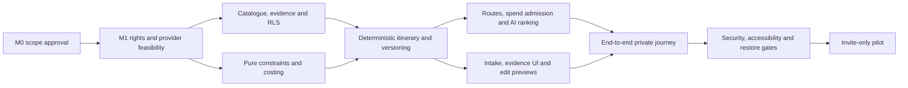

# Roadmap, risks and decisions

Current execution: **E2 local development** is authorized under [E2-01](m1/DECISION_REGISTER.md#13-e2-local-development-authorization), following Product Owner acceptance of the E1 local checkpoint. Scope: explicit evidence-bound meal scheduling, honest day utilization, lossless compact recommendation input and local UI/regression verification. Complete ranking, PD-01–PD-04 and all ceilings remain. No live API calls or E3 progression. M1 remains OPEN; M2/production acceptance is not granted. Historical phase descriptions below are retained as history, not new permissions. See the [product audit](PRODUCT_AUDIT.md) and [README](../README.md) for actual execution evidence.

## E2 authorized local checkpoint

E1 is accepted as a local checkpoint. E2 implements explicit meal scheduling, bounded fuller-day utilization, lossless compact AI input and corresponding accessible UI/regressions. Exit evidence: actual scheduled/unscheduled/conflict examples, before/after time accounting, 17/30/60 encoded-size and mock-admission measurements, full static/unit/integration/component/build/desktop-mobile/accessibility checks, current screenshots and known tradeoffs. No live provider call is part of this checkpoint; GEM-01 stays consumed.

Stop for Product Owner review after E2. E3 remains a proposal dependent on lawful operational content, a real independent reviewer, privacy/provider/storage decisions and any separately scoped account/spend/deployment approval. M1 remains OPEN; E2 does not satisfy these external gates or reduce the 30-place M5 target.

Current competition exception,2026-10-23: COMP-01 authorizes completing the local demo/editorial simulation/submission package without phase pauses; GEM-01 authorizes a server-only Gemini Free Tier adapter and exactly one attempted smoke request after mocks. That request failed without validated inference and exhausted its local permit; further live calls are disabled. These local deliverables do not accept M1/M2/M3 or change production scope. The historical B3 stop below was superseded for this bounded pass only; external release,rights,human review,retention and paid integrations remain gated. Final actual evidence is in [README](../README.md#competition-finalization-results).

Date: 2026-10-23. Planning direction approved; controlled local synthetic **Phase B3 — AI Recommendation and Personalization Readiness** is authorized under [DEVB3-01](m1/DECISION_REGISTER.md#9-controlled-local-phase-b3-authorization), following reported B2 review. M1 remains OPEN and M2 milestone acceptance is not granted. Production release and live external integrations remain unapproved. Milestone estimates are not committed dates. Current M1 findings and evidence are in the [M1 report](m1/M1_REPORT.md).

Update 2026-10-23: the Product Owner approved **PD-01–PD-04 product directions**, selecting **PD-04 Option A**; the [decision register](m1/DECISION_REGISTER.md) records the exact scope and outstanding human/evidence conditions. DEVA-01 permitted local Phase A; DEVB1-01 established the reported B1 core and DEVB2-01 the reported B2 editing/versioning. DEVB3-01 now supersedes the B2 stop only for mock AI recommendation readiness. The [blocker-resolution package](m1/BLOCKER_RESOLUTION_PACKAGE.md) tracks remaining M1 actions. No milestone exit, smaller launch scope, increased operating ceiling, live-test Stage B/C spending or provider/storage adoption is approved. Completed M1 experiments are not repeated without a changed hypothesis.

The approved directions confirm necessary-meal inventory across all trip dates including partial days, exact provided/prepaid portions and explicit remaining cost coverage with no generic exclusion; retain walking presets 2,000/4,000/8,000m and pace stop caps 3/4/5; fulfill every mandatory cultural category with at least one eligible scheduled visit trip-wide; and preserve 1–7 days, all hard requirements, all operating ceilings and a maximum five stops/day, preferring sparse/lower-density routing only where feasible. Maximum-density retry limits must be disclosed. Walking methodology/uncertainty/accessibility and real taxonomy/overlap/place classification still need competent independent review. These approvals are not verification evidence.

## 1. Delivery principles

Prove content rights and evidence coverage before real ingestion/provider use; prove deterministic feasibility before adding real model selection. DEVA-01/DEVB1-01/DEVB2-01/DEVB3-01 permit a clearly synthetic local UI, deterministic core, editing/version preview and mock recommendation readiness before those evidence activities, without consuming restricted provider content or real traveler data. Deliver one complete, private, editable Palembang journey before expanding catalogue breadth, languages or cities. Milestone acceptance still requires the evidence below; a demonstration without those checks does not establish readiness.

The proposed working team is one product/engineering lead, one full-stack engineer, one local content steward with an authorized reviewer, and part-time design/QA/privacy support. People may hold several roles, but may never approve their own catalogue contribution; publication needs a distinct human reviewer. Every launch duty must have a named accountable owner and backup. Estimates must be revisited if the team or content access differs.

## 2. Milestones and go/no-go criteria

| Milestone | Indicative effort after approval | Deliverables | Measurable exit gate | Accountable owner |
| --- | --- | --- | --- | --- |
| M0 — Planning approval | Direction approved on 2026-10-22 | Seven baseline documents and scoped M1 approval | Original approval covered documentation/isolated feasibility; DEVA-01 separately permits the local Phase A exception. Paid/external actions and milestone acceptance remain separate | Product owner |
| M1 — Evidence and engineering feasibility | 1–2 weeks | Source-rights register, sample independently verified records, approved schemas/rules, runtime/routing/cost/region spikes, dependency versions and initial CI conventions | Named operating owners; approved limits, legal/provider-content policy, retention/restore capability, fee/anchor policies and supported route modes. Route tests cover every launch mode and at least one geographic barrier case. Decide sync runtime versus durable queue using measured load. No unresolved decision may be deferred past its consuming integration | Engineering lead + content/privacy owners |
| M2 — Catalogue and deterministic core | 2 weeks | Reviewed catalogue/evidence workflow, schema migrations and RLS, pure planner/cost/validation, synthetic fixtures and version contracts | PRD AC-01–AC-04 and deterministic portions of AC-06/AC-08 pass; >=40 golden rule scenarios with independent invariants; a synthetic second city works without planner duplication. Unknown hours/prices and hard suitability gaps never pass validation | Engineering lead + reviewer |
| M3 — Routing and bounded AI orchestration | 1–2 weeks | Policy-aware map/route adapter, final leg validation, spend ledger/quotas, Responses adapter, deterministic fallback, run lifecycle and provenance rendering | AC-07/AC-12/AC-13 pass in fault tests; >=100 AI evaluation cases have zero unsupported factual leakage and zero unknown/cross-city IDs rendered. Matrix/route/token/money/retry ceilings hold under concurrency. Provider usage is reconciled and local route cases reviewed | AI/engineering lead |
| M4 — Complete traveler experience | 2 weeks | Mobile Indonesian intake, results/evidence, editable version previews, guest-to-account saving, private plan list and deletion | AC-05/AC-09/AC-10/AC-14/AC-15 pass; >=8/10 participants complete intake, inspect evidence and edit unaided; >=8/10 interpret facts, estimates and validated status correctly. Keyboard/screen-reader critical-flow review passes | Product/design + engineering |
| M5 — Invite-only pilot readiness | 1–2 weeks | Curated launch inventory, security/privacy QA, observability, recovery and incident runbooks, bounded staging evaluation and release checklist | All AC-01–AC-16 pass. >=30 approved places including>=10 food venues and>=3 cultural-interest categories; scenario coverage remains mandatory. >=3 locally reviewed feasible one-day scenarios collectively cover every supported transport mode. Restore meets approved RPO<=24h/RTO<=4h, deletion replay works, and source/rights/freshness gates pass | Product owner + engineering/operations |
| M6 — Pilot learning and city decision | Minimum 4 weeks of invited use | Outcome report, reviewed correction backlog, cost/latency measures, prioritized fixes and expansion proposal | Meet the observation criteria below; review operating costs and catalogue workload before admitting another city. Expansion requires a separate product-owner decision | Product owner + content lead |

The estimates overlap where independent work is possible; the critical path is roughly 7–10 engineering weeks after M0 with the proposed team, plus the pilot observation period. Source acquisition, contract/region decisions or staffing may extend it. Scope or timing changes must not weaken the integrity release gates.

Use [M1 acceptance criteria](m1/M1_ACCEPTANCE.md) to distinguish desk/local work from required reviewed samples and mode/barrier capability evidence. The three complete feasible, independently reviewed scenarios remain the original M5 gate. M1 does not inherit all M2 database/production tests or M5 deployed SLO/restore tests. Missing mandatory M1 human/rights/capability decisions still prevent M1 completion and an M2 go decision.

Staffing update from the user in the Phase B2 authorization: Project Product Owner confirms **20+ curator hours/week**, superseding the provisional 5-hour proposal. Independent reviewer remains unassigned with **0 confirmed hours**; 2–3 hours/week remains only the historical recruitment target and is below the modeled 7.78 ordinary reviewer hours/week. Sustainable capacity, peak/backup coverage and measured productivity remain unproven. No reviewer approval, signature or verification record exists. The modeled capacity gap, required scope/capacity decision and all-copy retention issue are documented in [operations feasibility](m1/OPERATIONS_FEASIBILITY.md).

## 3. Dependency and parallel-work plan

### Controlled local preview track — DEVA-01 / DEVB1-01 / DEVB2-01 / DEVB3-01

This execution track is distinct from milestone acceptance. It permits UI/foundation, reported B1 deterministic work, reported B2 editing/versioning and explicitly authorized B3 mock recommendation readiness while M1 evidence stays open; it does not lower any M1–M5 gate or adopt unresolved storage/provider choices.

| Development phase | Current authority | Scope and review boundary |
| --- | --- | --- |
| A — Foundation and UI/UX | Implemented/reported; Product Owner reviewed reported results and authorized B1 | Retain Phase A evidence separately; local UI tests do not pass M1/M2 |
| B1 — Deterministic itinerary core | Implemented/reported under DEVB1-01; Product Owner reviewed reported results and authorized B2 | Preserve historical 111 unit/integration/component and 34 browser passes separately; these do not pass M1/M2 |
| B2 — Interactive editing and immutable versioning | Implemented/reported under DEVB2-01; Product Owner reviewed reported results and authorized B3 | Historical 156 unit/integration/component and 48 desktop/mobile browser passes,20 configured axe scans and demonstrations remain in [README](../README.md#phase-b2-results); not B3 results or milestone acceptance |
| **B3 — AI recommendation and personalization readiness** | **Authorized under DEVB3-01; actual execution evidence to be recorded after checks** | Mock provider-independent ranking, strict versioned allowlists/reasons, alternatives, deterministic fallback and controlled source-linked explanations. Preserve deterministic feasibility and B2 history/locks, all caps and one shared 45-second deadline. At least100 categorized adversarial cases and actual static/build/accessibility/browser checks; **stop after B3 for review** |
| Real AI integration / further application work | Not authorized | B3 does not authorize SDK/provider configuration, accounts, credentials, live calls, authentication, production saving/persistence or editorial administration |
| C / original future AI-readiness description | B3 supersedes only the local mock-readiness portion | The original broader sequence is not automatic authorization; real AI/routing and every later increment still need separate approval |
| D — Editorial administration and QA | Future phase; do not automatically proceed | Content/evidence/review/publication interfaces and broader QA; cannot fabricate real reviewers, verification or publication approval |

Live-test spending stages B/C in the M1 proposal are separate labels and remain **unapproved**. Local development phase labels never authorize those calls or infrastructure. The 30-place M5 target, confirmed 20+ curator hours/week with unassigned reviewer and unproven sustainable capacity, Geoapify candidate status, disabled paid browser Maps and all operating ceilings remain unchanged. No credential configuration, external repository, billable provisioning, real traveler personal-data collection/storage or public deployment is authorized.

Curation and synthetic domain tests can proceed in parallel after evidence policy approval. UI design can use clearly synthetic data while schemas and planner stabilize. Provider integrations cannot outrun licensing, spend or privacy decisions. A queue, if M1 proves necessary, is infrastructure for M3 rather than a postponed reliability enhancement.

## 4. Pilot observation and expansion criteria

Invite-only pilot entry uses M5 gates. Proposed observation targets use at least 50 eligible planning sessions from at least 20 invited travelers over at least four weeks; report counts, exclusions and uncertainty, not only percentages. These are learning targets, not claimed demand estimates.

| Measure | Definition and target | Response if missed |
| --- | --- | --- |
| Validated yield | >=80% of completed, in-scope requests in the explicitly supported coverage scenarios produce a currently validated itinerary; separately report yield for all submitted requests and all failure/block reasons | Improve source coverage/constraints or narrow supported scenarios; never reclassify missing evidence as verified |
| Integrity | Zero displayed unsupported material facts and zero known hard-constraint violations in validated plans; review all factual incident reports | Disable affected place/provider/feature, correct evidence and revalidate; no expansion while a critical issue remains |
| Comprehension/usability | PRD moderated targets remain satisfied after wording or behavior changes | Revise trust labels and flows and repeat affected moderated tasks |
| Performance | At 10 concurrent requests, p95 generation<=30s and terminal outcome<=45s for the proposed synchronous design; reads and nonprovider edits<=2s. Report slowest/degraded results separately | Reduce bounded work or adopt the approved queue design; revise promises explicitly if necessary |
| Cost | Enforce approved hard caps; p95 variable one-day generation<=USD0.20 across >=100 benchmark requests; track each multi-day cohort and editorial/maps/hosting cost separately | Change optional work, provider/model choice or approved pricing/budget policy before scaling |
| Reliability | Target99.5% monthly core intake/saved-plan availability; measure provider-dependent validated-generation rate independently | Address incidents and capacity before expanding |
| Content operations | 100% of scheduled factual fields remain eligible at validation; daily freshness queue and urgent-revocation path have named coverage; no unresolved critical correction | Reduce published coverage until the city is maintainable |

Only include sessions in the primary supported-coverage metric when the definition was fixed before observation; publish the all-request denominator alongside it to prevent cherry-picking. User edits and returns to saved plans are engagement signals; actual route completion or spending must not be inferred without explicit research participation. Avoid live location collection just to create a success metric.

A second city needs its own curator, licensed evidence, timezone/currency/locale configuration, source freshness budget, route coverage, cost methods and golden scenarios. Begin with a synthetic city test to establish portability; no real second city is implicitly selected. Do not expand based on inventory count alone.

## 5. Release evidence and operating ownership

| Gate | Evidence to retain | Responsible role |
| --- | --- | --- |
| Product contract | Approved scope/defaults, all PRD acceptance outcomes and moderated task results | Product/design |
| Content truth | Source-rights register, field-level review events, local sample checks, expiry/revocation drill and scenario coverage report | Content steward + reviewer |
| Planning integrity | Golden corpus, independent invariant results, version/lock/edit tests and prompt injection/ID substitution results | Engineering/QA |
| Security/privacy | Cross-owner and editorial policy matrix, secrets/cache review, processor/region decisions, retention/deletion evidence and incident contacts | Engineering + privacy owner |
| Spend and dependency resilience | Rate/SKU version, concurrent reservation tests, failed/uncertain-charge reconciliation, kill-switch demonstration and quota configuration | Engineering/operations |
| Recovery | Timed backup restore, recovered ownership checks, deletion-ledger replay and rollback rehearsal | Operations |
| Launch | Named primary/on-call backup, invite limits, incident/correction communications procedure and authorization for the actual release | Product owner |

Production launch remains a distinct authorized external action. A passed milestone or merge does not automatically publish a site. Local Git initialization is authorized by DEVA-01; external repositories, messages/outreach, credential configuration, infrastructure and deployment still require their own authorization.

## 6. Risk register

Likelihood/impact ratings are planning judgments and must be revisited after M1 evidence collection.

| ID | Risk | Likelihood / impact | Mitigation and trigger | Owner |
| --- | --- | --- | --- | --- |
| R-01 | Too few current hours, prices or dietary/access fields for useful plans | High / High | Audit scenarios before promising coverage; resource local verification. Missing essential data => draft/block; no catalogue-count shortcut | Content/product |
| R-02 | Model output or ingestion introduces fabricated facts/identities | Medium / Critical | ID/evidence allowlists, approved text rendering, no autonomous ingestion, adversarial evals. Any unsupported leak blocks release | AI/engineering |
| R-03 | Schedule appears feasible despite closures, geography, last entry or inaccessible entrances | High / High | Date exceptions, final mode-specific legs, entry/return buffers, local reviews and expiry. Unreachable/unknown essential leg => draft/block | Planning/curator |
| R-04 | Source licensing or Maps restrictions conflict with saved plans/AI/display | Medium / High | Field-by-field rights review before ingestion/integration; independent catalogue; restricted content not in immutable backups/prompts. Switch adapter or scope if unsuitable | Commercial/legal + engineering |
| R-05 | Sensitive preferences or precise locations leak across users/caches/logs | Medium / Critical | RLS, private no-store responses, owner tests on nested entities, minimized/redacted context, retention and deletion drills | Engineering/privacy |
| R-06 | Paid API usage, replay or anonymous abuse exceeds budget | High / High | Atomic reservations, aggregate retry caps, bounded matrix elements, environment quotas, restricted browser keys and emergency disable path | Operations |
| R-07 | Provider outage or serverless deadline prevents generation | Medium / High | Deterministic AI fallback, honest route drafts, deadlines/circuit breakers and runtime spike; durable queue when required | Engineering |
| R-08 | Backup/processor behavior makes deletion or recovery promises unachievable | Medium / High | Verify actual plan/vendor capability at M1; approve revised promises before launch; deletion replay before restored access | Privacy/operations |
| R-09 | Cultural context is inaccurate, reductive or disrespectful despite fluent prose | Medium / High | Reviewed claim text, field-appropriate sources, community/context review and rapid corrections; no unsupported translated claims | Content lead |
| R-10 | Editorial workload exceeds staffing as content/cities grow | High / High | Fund named city owners, track freshness backlog and pause expansion when coverage deteriorates | Product/content |
| R-11 | Users mistake estimated prices, walking access or suitability for guarantees | Medium / High | Visible ranges, evidence scope, unknowns and comprehension tasks; no inferred allergy safety or live ride availability | Product/design |
| R-12 | Requirements drift or heavy abstractions delay the core journey | Medium / Medium | Modular monolith, one city/trip, named non-goals and milestone review; add services only after measured need | Engineering/product |

## 7. Unresolved decision register

Approval to start implementation does not answer every question. Resolve each before its dependent work or external action. Any unresolved launch blocker holds the pilot.

| ID | Decision and current recommendation | Decision owner | Due / blocks |
| --- | --- | --- | --- |
| D-01 | PD-04 retains 1–7 days and current scope/hard requirements. Other baseline intake details (Indonesian,90-day horizon,1–8 travelers, same-day availability, group IDR budget and mode eligibility) remain subject to their recorded operational/evidence conditions; no new scope change is implied | Product owner | M0/M1; intake/domain scope and evidence |
| D-02 | Name local evidence sources, rights/authority hierarchy, reviewer and proposed freshness windows | Product + content owner | M1; publication and real-data ingestion |
| D-03 | PD-01 necessary-meal inventory, PD-02 walking/pace presets and PD-03 trip-wide mandatory-category semantics are product-approved. Numerical estimate/allowance methods, uncertainty, accessibility, real taxonomy/overlaps/classifications, 10% contingency, dwell/queue buffers, fee-band/anchor and remaining daily coverage details still need scoped approval/evidence | Product + competent content/access/engineering reviewers | M1; validator correctness; product direction does not close evidence gates |
| D-04 | Approve selected provider and per-field display/retention/derived-output/AI rights. Google remains conditional; Geoapify remains a candidate only. Paid embedded browser Maps stays disabled pending separate rights/budget decision | Commercial/legal + engineering; Product/budget for browser exposure | M1; routing integration and saved route representation |
| D-05 | Choose supported dependency releases, Supabase access transport and runtime/queue/scheduler from measured spikes | Engineering | M1; production architecture commitment |
| D-06 | Choose hosting/DB regions and plans; review volatile-storage costs, retention guarantees, privacy and guest-loss implications before adoption; verify RPO/RTO, backup expiry and cross-border processor terms. No storage adoption/provisioning is approved | Engineering + privacy/operations/budget owners | M1; any real private data and service promises |
| D-07 | Select model/snapshot and current rates against evaluation; choose credentials through an approved secure setup when implementation requires it | AI/engineering + budget owner | Before paid AI work; no keys needed for current planning |
| D-08 | PD-04 retains existing USD1/paid operation, USD10/day, USD100/month ceilings and all shared quotas/work/time caps; this authorizes no spending. Provider rates, hosting allowance and FX/tax margins remain to review. Stage B and Stage C remain unapproved | Budget owner | Separate explicit authorization before any paid integration or infrastructure work |
| D-09 | Choose sign-in method, editor stronger-auth policy, age policy and public privacy/consent text | Product + security/privacy | Before auth integration with real users |
| D-10 | Approve feedback triage SLA, support/incident ownership, analytics event consent/retention and deletion-ledger retention | Product + operations/privacy | Before invited pilot |
| D-11 | Confirm release corpus, 10-concurrent load profile, user sample and scenario coverage targets | Product + QA/content | M1; release evaluation |
| D-12 | Whether later demand warrants English, public sharing, reservations, public transit, river experiences or multi-city trips | Product owner | After pilot; outside MVP |

Architecture-specific details are cross-referenced as A-01–A-07 in [Architecture](ARCHITECTURE.md). These registers describe the same approvals at different levels; do not treat a decision as approved merely because a default appears in a schema.

## 8. Concise decision log

| Decision | Status | Reason |
| --- | --- | --- |
| DEVA-01: controlled local synthetic Phase A foundation/UI implementation and local Git/dependencies/tests | Historical Product Owner approval, 2026-10-23; results reported | Later B1/B2/B3 scoped authorizations supersede each preceding stop only for their local increment; M1 stays OPEN and no external gate closes |
| DEVB1-01: controlled local synthetic deterministic itinerary core, fixture adapters and substantive tests | Historical authorization/results, 2026-10-23; reported results reviewed for B2 progression | Does not grant M2 acceptance, production persistence, paid/external actions or factual approval |
| DEVB2-01: local synthetic interactive editing, preview and immutable in-memory versioning | Historical authorization/results, 2026-10-23; reported results reviewed for B3 progression | Full current revalidation, explicit commits, retained history and stale-base rejection remain invariants; no real AI/authentication/saving/editorial or external action |
| DEVB3-01: local mock AI recommendation/personalization readiness; stop after B3 | Product Owner approved, 2026-10-23 | Strict IDs/evidence/reasons, bounded mock attempts/admission, deterministic fallback and categorized adversarial tests preserve B1/B2; no live API configuration or next-phase authorization |
| PD-01: confirmed daily necessary-meal inventory, including partial days, exact provided/prepaid portions and explicit cost coverage; no generic exclusion | Product Owner approved, 2026-10-23 | Prevents hidden necessary-meal budget omissions; real allowance methods still need review |
| PD-02: retain 2,000/4,000/8,000m walking presets and 3/4/5 pace stop caps | Product Owner approved, 2026-10-23 | Preserves numeric planning limits; physical methods, uncertainty and accessibility still need competent review |
| PD-03: at least one eligible scheduled visit trip-wide per mandatory cultural category | Product Owner approved, 2026-10-23 | Makes mandatory fulfillment explicit; real taxonomy, overlaps and classifications remain pending independent cultural review |
| PD-04 Option A: preserve 1–7 days, five stops/day maximum, hard requirements and all operating ceilings; prefer feasible sparse/lower density and disclose recovery headroom | Product Owner approved, 2026-10-23 | Avoids silent constraint relaxation; maximum density has no guaranteed retry capacity or live-feasibility proof |
| Retain 30-place M5 target (>=10 food, >=3 cultural categories); Product Owner confirms 20+ curator hours/week; reviewer remains unassigned and sustainable capacity unproven | Product Owner direction retained, 2026-10-23 | Smaller M1 samples measure evidence/workload and do not change launch scope |
| Geoapify candidate only; paid browser Maps disabled; volatile architecture unadopted; Stage B/C unapproved | Product Owner boundaries, 2026-10-23 | Rights, cost, retention, privacy and external-action approval remain prerequisites |
| Palembang first, one city per trip, city-keyed reusable domain | Recommended | Concentrates verification while enabling future city additions |
| Independently verified catalogue and field-level provenance | Required invariant | Prevents destination/fact invention and supports corrections |
| AI ranks approved IDs; deterministic code owns facts, times, cost and constraints | Recommended architecture enforcing required truth rule | Makes outputs auditable and provider failure recoverable |
| Unknown/stale/conflicted essential data cannot pass validation | Required invariant | Missing data must remain visible and cannot become a fabricated fact |
| Next.js/TypeScript modular monolith with Supabase/PostGIS; conditional Google/Vercel adoption | Provisional after tradeoff review | Balances pilot delivery with maintainability, subject to terms/runtime/region proof |
| Private immutable plan revisions with current revalidation | Recommended | Protects edits/history without presenting old evidence as current |
| Bounded work, central spend admission, deterministic fallback and provider adapters | Recommended | Controls costs and failure behavior without open-ended agents |

## 9. Recommended implementation order

1. Following reported B2 review, implement/test the authorized DEVB3-01 provider-independent mock ranker and strict structured allowlists/reasons, alternatives and deterministic fallback through a narrow planner boundary. Demonstrate three contrasting synthetic profiles, structured output, invalid rejection/fallback, retained B2 editing/history and at least 100 categorized adversarial cases; report actual files/checks/limits and stop after B3 for Product Owner review. PD-01–PD-04 and M1 evidence gates remain unchanged.
2. Run minimal, budgeted feasibility spikes after authorization; decide supported stack versions, route coverage, runtime/queue and provider content policy.
3. Establish catalogue/evidence schemas, publication/ownership policies, synthetic fixtures and independent constraint tests.
4. Build the pure deterministic cost, time, pace and constraint engine with versioned validation reports; prove missing-data behavior and second-city portability.
5. Build editorial review/publication and curate the scenario-backed Palembang inventory in parallel with the engine.
6. Add final route validation, spend reservations, run lifecycle and bounded AI selection with deterministic fallback.
7. Connect intake, source-aware results, edit previews, private versioned saves and deletion into one complete journey.
8. Complete security, accessibility, cost/load, local-context, backup/restore and incident checks; seek separate launch authorization for the invite-only pilot.
9. Observe pilot quality and operations, resolve findings, then decide expansion with evidence.

Stop after the authorized Phase B3 mock-readiness increment for Product Owner review before real API integration or further implementation. Report actual local evidence separately from M1; do not declare M1 complete, M2 accepted or production ready while mandatory evidence is pending. No approval for live/billable calls, credential/provider configuration, external repositories/accounts, provisioning, real traveler data or public deployment has been given.

Local B3 checkpoint, 2026-10-23: implemented and stopped for review after lint/typecheck/format/build passed, 366 unit/integration/component tests and 62 desktop/mobile Edge tests passed, and 26 configured axe state scans had zero violations. The 120-case synthetic adversarial corpus rejected every attacked output; three contrasting synthetic profiles and B2 immutable-editing regressions are recorded in [README](../README.md#phase-b3-results). These are mock/local contract results; no M1/M2/M3 milestone or production exit is granted by them. Remaining rights, human review, staffing capacity, provider/live capability, privacy/retention/region and separately scoped spending gates retain their existing owners and evidence requirements.
