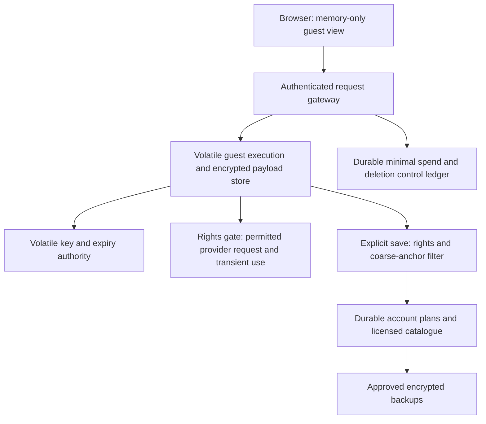

# Short-retention storage design for M1 review

Date: 2026-10-23, Asia/Jakarta. **Proposed architecture only; not implemented, approved, provisioned or verified.** M1 remains OPEN. This design preserves the existing 24-hour maximum guest-content lifetime, source-specific restrictions and saved-plan recovery targets. It does not assert that TTL, encryption, a managed cache or ordinary database deletion satisfies all-copy erasure.

Related: [existing operations assessment](OPERATIONS_FEASIBILITY.md), [provider comparison](PROVIDER_COMPARISON.md), [logical schema](../DATA_MODEL.md), [decision register](DECISION_REGISTER.md), [blocker package](BLOCKER_RESOLUTION_PACKAGE.md).

## 1. Recommendation and decision boundary

Separate durable, rights-eligible catalogue/account data from guest content and restricted provider results. Use a dedicated volatile execution/storage boundary with no payload persistence or backups, absolute expiry and short-lived encryption keys. Keep independently permitted immutable plans in PostgreSQL. Source rights decide whether a provider result can enter even volatile storage or calculation; this design grants no permission to use or retain a restricted field.

This is a technically testable option, not a selected service. It adds operating components beyond the initial Next.js/Supabase monolith because ordinary database backups cannot meet the short-TTL contract. It requires an explicit architecture/operations/region decision, cost quote and later configuration approval. The previous optional USD60 infrastructure proposal does **not** include this additional service or establish its affordability. Do not provision it or raise existing ceilings.

| Option | Retention properties | Delivery/operations tradeoff | Recommendation |
| --- | --- | --- | --- |
| One backed-up Postgres database, delete guest/provider rows at expiry | Prior backup/WAL/log copies can outlive the row. Encrypting disk does not remove per-record key access | Simplest integrity model, fails the current literal short-retention design requirement | Reject for short-TTL payloads |
| Dedicated nonpersistent volatile service, payload encryption and volatile key boundary | Excludes payloads/keys from intended disk/backup paths; independent access/key expiry blocks use. Requires actual host/provider evidence and sanitization assessment | More operations; guest progress can disappear on failure; no durable guest recovery | Preferred candidate for assessment, subject to approval/proof |
| Durable ciphertext with per-record keys destroyed at expiry | Can make ciphertext inaccessible only if all key/plaintext copies are controlled; ciphertext still physically exists | Preserves recoverable ciphertext before expiry but complicates key availability and license interpretation | Conditional alternative only if privacy/rights owners accept crypto-erasure and encrypted backup retention explicitly |
| Browser-only guest graph | Reduces server persistence, but browser storage/telemetry/devices and server provider work remain; refresh/device loss and privacy behavior differ | Changes recovery and trust boundary, does not alone solve restricted provider storage or spend admission | Not a silent substitute for approved server contracts |

## 2. Four physical data planes

| Plane | Permitted contents | Physical exclusions / expiry |
| --- | --- | --- |
| D — durable application data | Approved independent catalogue assertions, account-owned intent and rights-eligible immutable versions, source/policy IDs | Database and lawful object backups with approved retention; exclude all short-TTL guest payloads/keys and restricted derivatives. Deletion/withdrawal overlay and restore replay remain required |
| E — volatile content | Guest request/versions, precise anchors, temporary candidate/evidence projection and permitted provider payloads/derivatives | RAM-only proposed service; no RDB/AOF, disk tier, snapshots, backups, exports, persistent queues, tracing bodies or crash dumps. Each object has absolute deadline and dependency expiry |
| K — volatile keys | Random per-guest and per-provider-object data keys, authorization context, absolute expiry and short leases | Separate access boundary; no persistent wrapped key, escrow, replica snapshot or deterministic regeneration from a long-lived master. Keys and all authorized worker copies expire no later than data |
| L — durable control metadata | Minimal charge/reservation totals, units and policy versions, uncertain-charge state, content-free account deletion/rights suppression ledger where lawful | No guest preferences, exact locations, routes, model prompts or source payloads. Opaque identifiers do not by themselves establish anonymization; approve necessary linkability/retention separately |

The E/K split is a defense against accidental copies, not a claim of isolation from a fully compromised host. A dedicated key authority can share an operated service boundary initially if its permissions and loss behavior are explicit; it cannot be described as independent security isolation then. A serverless function's in-process map is not the shared E/K service: multiple workers, restarts and autoscaling require one authoritative expiry/admission boundary.

**Browser boundary:** server-controlled expiry cannot physically erase a traveler's frozen tab, back-forward cache, device memory, screenshot or saved copy. Proposed client controls are memory-only state, no service-worker/private response caching, `no-store` response handling, an expiry timer and mandatory expiry/session recheck on visibility, resume, navigation and reconnect; purge the displayed graph on expiry/sign-out or failed recheck. A suspended browser may not run that timer. Define the promise's first-party service/copy scope explicitly with the privacy owner, and do not claim key destruction erases plaintext already rendered on a device. No broader deletion promise or wording change is adopted here.

The original logical schema's guest foreign keys cannot span RAM and PostgreSQL unchanged. Proposed adaptation: durable account/canonical entities retain database-enforced ownership/FKs; guest content relationships are checked inside the volatile service, with a narrowly typed durable operation envelope containing no content. The guest-to-account claim needs the staged protocol below. This physical change requires a reviewed schema design and later tests; no migration is supplied.

## 3. Expiry, encryption and key lifecycle

1. Establish guest creation time at the server and compute `guest_deadline = created_at + 24 hours`. Retries, reads, edits, login and save attempts cannot extend the original guest graph. A saved lawful account copy is a separate object with explicit consent/ownership.
2. For each permitted provider object compute `object_deadline = min(guest_deadline when applicable, permitted_provider_expiry, source_validity_limit, user_deletion_deadline)`. Some content permits no caching at all; keep only request-local buffers if the approved purpose allows that, otherwise do not fetch/use it. “Not cached” is not permission for transient derivative processing.
3. A proposed encryption envelope uses an approved authenticated encryption implementation (candidate AES-256-GCM) with random per-object data keys and unique nonces. Authenticate object/owner/policy/deadline metadata; a caller cannot change expiry or owner by editing ciphertext. Review nonce limits and key generation in the selected implementation. Do not write a custom cryptographic primitive.
4. K serves decryption only to a scoped worker lease while policy, principal and deadline remain valid. Prefer a service operation rather than copying exportable keys into long-lived web workers. If key/plaintext must cross a process, enumerate every copy and bound its lifetime. General Node/JavaScript garbage collection is not evidence of secure key or plaintext zeroization.
5. Proposed safety policy: stop new work/key leases sufficiently before expiry to drain all bounded in-flight work; derive the cutoff from the maximum worker lease, clock uncertainty and sanitization margin. The operation deadline remains at most45 seconds and may be shorter when source expiry is close. No caller receives a lease extending beyond its object's deadline. The exact margin is a configuration decision to validate, not an approved new service target.
6. At expiry/deletion, deny reads immediately, revoke leases, destroy key material using the reviewed implementation's sanitization mechanism, remove ciphertext and derivative entries, and record content-free completion/failure evidence. A key tombstone must never retain a recoverable wrapped key. Expiry sweeps supplement read-time checks; they do not prove memory sanitization.
7. On key-service loss/restart, keys are not recovered from durable seeds or backups. A new service epoch makes surviving stale session tokens unusable. Guest work is lost gracefully; paid calls are not automatically replayed. If durable reconstruction of a key remains possible, crypto-erasure has not happened.

Operation elapsed time uses a monotonic clock from server acceptance, capped at45 seconds including admission/queue wait. Object/source expiry uses trusted UTC plus a validated clock-uncertainty margin. The effective remaining lifetime is the minimum of both. Check it before dispatch, issuing a key lease, accepting a provider response and committing/activating a saved projection. A late response is discarded/purged and cannot revive a plan; its possibly incurred charge stays reserved for reconciliation. An untrusted clock or inability to bound the margin fails closed. No request restarts a deadline by moving between workers.

NIST's sanitization guidance makes cryptographic erasure conditional on correct encryption/key handling and the ability to sanitize all relevant key copies; escrow/recoverable keys undermine it. This supports a review criterion, not certification of this proposed application. [NIST SP800-88r2, §§3.2–3.2.5](https://nvlpubs.nist.gov/nistpubs/SpecialPublications/NIST.SP.800-88r2.pdf).

## 4. What “RAM-only” must actually mean

A Redis-compatible service is one candidate, not an adopted dependency. Official documentation permits disabling persistence, but enabling replicas can introduce an RDB file during full synchronization; diskless replication is a separate setting. Therefore “AOF off” alone is insufficient. [Persistence](https://redis.io/docs/latest/operate/oss_and_stack/management/persistence/), [replication, Diskless replication](https://redis.io/docs/latest/operate/oss_and_stack/management/replication/).

The later configuration review must establish, across primary, replicas, failover/control-plane and host:

- No payload AOF/RDB/manual backup/export, storage tiering, persistent queue, change-data capture or development copy; deny operational commands that could create them except in separately approved synthetic tests.
- No disk-backed swap, hibernation image, process/host core dump, payload heap profile, debugger snapshot or crash/diagnostic upload. Review hypervisor/provider snapshots too; a container option does not prove host behavior.
- Any replication/resynchronization remains memory-to-memory and honors expiry/epoch. A replica cannot restore expired keys or serve stale content during partition. If these controls cannot be evidenced, use a different service or keep the design blocked.
- Infrastructure/SDK/proxy/APM/browser tooling does not record request bodies, query strings with anchors, cache objects or keys. Session tokens are opaque and only stored in secure session cookies; do not put them in URLs or browser persistent storage.
- Per-object absolute TTL is checked on read/use/write. Updating an object must retain the original earlier deadline; no rolling renewal. Expiry contains UTC instants and a monitored clock policy; clock rollback or untrusted expiry state denies use rather than extending access.

Redis describes active and passive key expiration; these are keyspace/access mechanisms, not a statement of byte-level zeroization or old-copy erasure. Use the separate key/sanitization and copy-inventory controls above. [EXPIRE, Expires and persistence / How Redis expires keys](https://redis.io/docs/latest/commands/expire/).

**Unresolved guarantee:** no selected host/runtime presently proves physical erasure of every plaintext/key byte by the deadline. Keep that evidence gap explicit. A privacy owner must decide whether a documented sanitization/access-infeasibility standard satisfies the current wording; if changing the promise to active-data expiry plus backup retention, obtain explicit product approval. A provider's physical-copy restriction cannot be weakened through that wording decision. Encryption cannot authorize storage that a license prohibits, even if the ciphertext is unreadable later.

## 5. Save, spend and deletion across stores

### Guest-to-account save

Do not claim a distributed transaction between a volatile store and PostgreSQL. Use a bounded staged operation:

1. Authenticate and obtain an explicitly confirmed Save request plus coarse/canonical anchor choices while E/K and the guest deadline permit it. Reserve a durable **content-free** unique claim key bound to the original guest lineage, authenticated account, original expiry, request/base revision, execution epoch and monotonic fencing sequence. A volatile lock is an optimization, not the ownership/idempotency authority. Another account cannot acquire that claim.
2. Prepare and revalidate the lawful account projection in volatile memory; no durable staging graph or request body is written. Use an approved scoped preparation authorization that cannot outlive the guest/object deadline or operation lease. If a derivative cannot be stored, do not copy it or describe an incomplete intent-only copy as the complete immutable itinerary promised by the baseline.
3. In one durable transaction, lock the claim, check account binding/current fence/authorized epoch and stored absolute expiry, recheck source-head/policy revisions, insert account-owned request/version/child rows and mark the claim consumed. Only then expose the account version. A stale worker cannot activate using an older fence. Every replacement worker increments the authoritative fence; epoch transition and issuance of further work require the durable coordinator's approval. Lost coordinator/lease authority fails closed. Repeated same-account submission returns the committed mapping; no account rebinding.
4. Preparation failure/expiry discards E/K buffers and updates only the content-free claim. The original guest graph keeps its expiry. If the durable transaction commits but its HTTP response is lost, the lawful account copy exists because the explicit Save was committed; idempotent status lookup reports that outcome rather than pretending no saved copy exists or recreating one. Normal account-deletion/backup rules apply to that deliberate copy, not a new guest TTL.

This avoids a pre-activation durable payload whose failed-save copy could already be in WAL/backups. A later design that introduces durable staging must explicitly establish lawful account ownership/retention **before the first write**, obtain product/privacy approval and handle failed-stage erasure across backups; hidden visibility alone never makes a backed-up graph ephemeral. Coordinated epoch/lease/fence behavior, partition timing and the final transaction must be reviewed and tested; this proposal does not assert a cross-store ACID guarantee or instantaneous crash detection.

No guest deadline or provider restriction is extended by this protocol. A crash cannot guarantee recovering unfinished guest work, but must never create duplicate account copies or unadmitted calls. Schema FKs for durable staging, unique claims, leases and cross-store failure cases remain a later implementation review/test obligation.

### Minimal spend and abuse metadata

Paid-work admission must survive volatile content loss without storing the itinerary. Keep only necessary operation/reservation/unit/rate/error metadata in L if lawful. Mark uncertain charges conservatively; losing E/K does not refund/retry automatically. Principal-to-guest-operation mappings, guest content and linkable precise request hashes expire in E/K. Never store an enumerable hash of low-entropy preferences/coordinates as an alleged content-free identifier.

**Decision required:** the baseline's30-day operational metadata and24-hour guest graph rules need an explicit classification for unavoidable provider-attempt/billing IDs and guest abuse digests. Proposed policy is short-lived guest linkage (no later than24 hours), minimally necessary unlinked financial metadata under a separately approved retention, and aggregate statistics thereafter. Whether any residual identifier remains personal/linkable requires privacy review; no anonymity guarantee or30-day guest-content exception is approved here. If a provider ID itself retrieves restricted content, omit it or honor its shorter policy.

For guest deletion, stop access/work first, then destroy E/K objects and derived data. For saved account deletion, deny access immediately and purge active durable copies within the existing72-hour target. The separate deletion ledger suppresses deleted accounts/content before any restore; its access and expiry are justified by actual backup windows. Deletion replay prevents restored access but never substitutes for physical expiry of backups.

## 6. Backup and restore plan

| Class | Backup policy | Failure / restore behavior |
| --- | --- | --- |
| E/K guest/provider content | None, including replicas' disk snapshots and operational exports | Restart empty with a new epoch; show expired/unavailable guest state. Guest progress has no durable recovery guarantee. This is the cost of the proposed short-retention design, requiring product acknowledgement |
| Rights-eligible account/catalogue data | Approved encrypted backups; maximum retained private backup age remains30 days | Restore into quarantined environment; verify current licenses/expiry, replay independent deletion/revocation ledger, enforce owner isolation and recompute effective validation before reopening |
| Durable minimal spend ledger | Approved retention/copies, no reconstruction of guest payload | Reconcile actual/uncertain charges, prevent replay of lost operations; no regeneration from stored request bodies |
| Source-restricted ephemeral derivatives | No durable backup/export or implicit JSON/validation-summary copy | They cannot reappear from a plan/version snapshot; replace expired fields with markers. A full immutable-plan promise needs a rights-eligible durable source, not this marker alone |

Saved-plan RPO<=24h/RTO<=4h remain unchanged targets and require a later timed restore drill. This design makes no new availability/SLO claim. The volatile tier's failure and extra compute/network/key-service costs must be measured and included in a new approved quote; they are not free because payloads are not backed up.

## 7. Acceptance evidence and next actions

| Evidence gap | Next executable action without credentials/spend | Human/account evidence needed later |
| --- | --- | --- |
| Meaning of all-copy expiry and acceptable sanitization | Review this copy/key inventory and draft retention wording | Product + privacy/rights owners approve semantics; no deadline weakening by implication |
| Actual no-persistence host, replicas, logs and dumps | Prepare exact service/vendor questionnaire and synthetic verification cases | Operations obtains documented capabilities/account configuration under later provisioning approval |
| Key generation, nonce, zeroization, leases/clock/failure behavior | Specify threat model and audit checklist; no implementation in this task | Security engineer reviews selected implementation and later synthetic tests |
| Physical split/FK/save semantics | Review logical-to-physical mapping and staged-claim states | Engineering approval before M2 migrations; real DB/cross-store proof later |
| Provider rights for transient and durable derivatives | Use clause-by-purpose [provider comparison](PROVIDER_COMPARISON.md) | Actual agreement/positive permission or licensed alternative, before consuming content |
| Backup/deletion/restore isolation | Prepare marker-data drill: expired guest, revoked source, staged save and account deletion | Separately authorized synthetic environment and timed evidence; production promises remain pending |
| Region/cost/operating owner | Add tier to a line-item quote request without creating an account | Exact region/privacy approval, accountable operator and gross spending ceiling; old proposal does not cover it |

No experiment, migration, credential or service configuration was performed for this design. It advances the retention decision from an identified conflict to a concrete reviewable option; mandatory feasibility and rights evidence remains pending.
